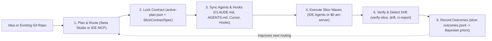

# AnvilMark — Complete Capabilities & Intended Flow

> **Document Purpose:** Single source of truth for everything AnvilMark can do across Web, CLI, MCP, IDEs, Guardrails, and CI/CD, how the end-to-end user workflow fits together, and the blueprint for updating the **Work Locally** (`/start`) page.
>
> **Last Updated:** November 27, 2026  
> **Scope:** Implemented capabilities on `feat/beta-studio-and-local-flow` (`beta0.3`).

---

## 1. Core Product Premise

**AnvilMark is a local-first architecture planner, model router, and deterministic conformance layer for AI-assisted software engineering.**

AnvilMark does **not** lock you into a proprietary coding agent, host a mandatory cloud inference proxy, or upload your source code to inspect your repository. Instead:

- **You bring your existing intelligence & tools:** Claude Code, Codex, Cursor, VS Code, Antigravity, your own API keys, or local open-weight runtimes (`am-server` / `llama-server`, Ollama, vLLM).
- **AnvilMark owns the deterministic spine:** structural repository scanning (no source code or secrets), explicit architecture & trust-boundary contracts, empirical per-slice model routing, enforceable file/boundary guardrails, polyglot static drift verification, and provenance/outcome telemetry.



---

## 2. Complete Capability Matrix

### 2.1 Web Surfaces (`packages/web`)

| Route                                                                        | Nav Label           | Purpose & Implemented Capabilities                                                                                                                                                                                                                                                                                                                                                                                                                                                                                                                                                                                                                                                                                                                         |
| :--------------------------------------------------------------------------- | :------------------ | :--------------------------------------------------------------------------------------------------------------------------------------------------------------------------------------------------------------------------------------------------------------------------------------------------------------------------------------------------------------------------------------------------------------------------------------------------------------------------------------------------------------------------------------------------------------------------------------------------------------------------------------------------------------------------------------------------------------------------------------------------------- |
| **`/`**                                                                      | Home                | High-level product value proposition, 3-step workflow summary, and entry CTA into `/beta`.                                                                                                                                                                                                                                                                                                                                                                                                                                                                                                                                                                                                                                                                 |
| **`/beta`**                                                                  | Plan a change       | **Beta Planning Studio** — conversational 3-mode planner (`chat` → interactive `clarify` cards → structured `plan`) with live SSE streaming, multimodal screenshot/diagram & structural repo-context intake, SQLite model routing catalog with freshness indicators, Subscription & Quota Arbitrage modes (`plenty`, `conserve`, `exhausted`), Bayesian outcome-informed routing, interactive Architecture & Trust-Boundary `FlowGraph` with **Drift Radar**, inline editable `SliceContractSpec` + per-slice verification, Session History drawer, and 6-tab **Shift to Local Development** Handoff Studio (Master Brief, Per-Slice Prompts, `CLAUDE.md`, Cursor `.mdc`, Codex `AGENTS.md`, CLI Bundle + 1-click **Apply to repo ⚡** over Local Bridge). |
| **`/models`**                                                                | Models              | **Model Atlas** — searchable catalog of model offers with pricing, context windows, capabilities, release timelines, Arena leaderboard comparison, and interactive Hardware Sizing cockpit.                                                                                                                                                                                                                                                                                                                                                                                                                                                                                                                                                                |
| **`/start`**                                                                 | Work locally        | **Local-First Onboarding Guide** — _(currently outdated; see Section 6 for the planned update covering 1-command `npx anvilmark connect --with-hooks`, Terminal Cockpit, Browserless MCP, and `/beta` Bridge)._                                                                                                                                                                                                                                                                                                                                                                                                                                                                                                                                            |
| **`/workspace`**                                                             | Your records        | **Read-Only Local Run Reader** — inspects `.anvilmark/development/runs/*.json` purely in browser memory (configured vs. served models, diffs, check results, cost basis) with zero upload.                                                                                                                                                                                                                                                                                                                                                                                                                                                                                                                                                                 |
| **`/plan`**, **`/demo`**, **`/studio`**, **`/playground`**, **`/dashboard`** | Contextual / Legacy | Legacy single-shot planner (`/plan`), Atlas synthetic training workshop & bundle viewer (`/demo`, `/studio`, `/playground`), and optional account console (`/dashboard`, `/login`).                                                                                                                                                                                                                                                                                                                                                                                                                                                                                                                                                                        |

---

### 2.2 Local CLI (`anvilmark` / `npx anvilmark`)

The standalone CLI (`packages/cli`, bundled via `scripts/build-npm-package.mjs` into a `0.69 MB` `npx`-ready package with 3 binaries: `anvilmark`, `anvilmark-project-mcp`, `anvilmark-mcp`) provides 30+ commands grouped by lifecycle stage:

#### A. Onboarding, Mission Control & IDE Wiring

- **`anvilmark`** (no args) / **`anvilmark cockpit`** — Terminal Mission Control dashboard displaying connected IDE/agent targets, active locked plan & dependency DAG waves, live architecture drift status, guardrail hook status, and empirical model win-rates.
- **`anvilmark connect [--target claude|codex|cursor|vscode|antigravity|all] [--with-hooks] [-C DIR] [--json]`** — 1-command idempotent wiring that configures local MCP servers, slash commands, rules, and skills across all 5 major coding environments:
  - **Claude Code:** `.mcp.json` + `.claude/commands/anvilmark-{plan,next,cockpit}.md`
  - **Codex:** `.codex/config.toml` (marked block with `--local-studio --slice-execution`)
  - **Cursor:** `.cursor/mcp.json` + `.cursor/rules/anvilmark-workflow.mdc`
  - **VS Code:** `.vscode/mcp.json`
  - **Antigravity:** `.agent/skills/anvilmark/SKILL.md` (and installable global plugin in `plugins/anvilmark`)
- **`anvilmark hooks <install|uninstall|status|run> [--target git|claude|all] [--claude-stop] [-C DIR] [--json]`** — Active deterministic local guardrails (`<300 ms`) wired into Git `pre-commit` and Claude Code `Stop` hooks (`.claude/settings.local.json`) to block `.env`/secret leaks, forbidden file globs, unapproved dependency changes, and slice scope escapes before commits or agent turn completion.

#### B. Planning, Handoff & Zero-Copy Web ↔ Repo Bridge

- **`anvilmark export-context [-C DIR] [--out FILE]`** — Emits privacy-safe structural repository metadata (languages, directory layout, manifests, frameworks, observed entrypoints, git branch — **never source code or secrets**) for `/beta` Studio or MCP planning.
- **`anvilmark apply-plan --file <bundle.json> [--target all|claude|codex|cursor] [-C DIR]`** — Validates a `PlanHandoffBundle` (`anvilmark.plan-handoff.v1`), locks `.anvilmark/development/active-plan.json`, generates `PLAN.md` and `master-prompt.md`, and syncs marked instruction blocks into `CLAUDE.md`, `AGENTS.md`, and `.cursor/rules/anvilmark.mdc`.
- **`anvilmark bridge [-C DIR] [--port 4317] [--allow-origin ORIGIN] [--allow-check CMD] [--token-file PATH]`** — Authenticated loopback daemon (`127.0.0.1` only, bearer token + explicit Origin CORS allowlist) pairing `/beta` Studio directly to a local repository for:
  - 1-click repo context + empirical outcome sync into `/beta`
  - 1-click **Apply to repo ⚡** (no file download/upload)
  - Remote **Verify slice** execution & real-time SSE event streaming (`slice_status`, `plan_applied`, `drift_updated`)
  - Live **Architecture Drift Radar** overlay on the `/beta` FlowGraph.

#### C. Slice Execution, Verification, Worktree Isolation & Drift Detection

- **`anvilmark next [--slice <id>] [--exec] [--runner auto|claude|codex|am-server] [--endpoint URL] [--max-attempts N] [--run-checks] [-C DIR] [--json]`**
  - Resolves the dependency DAG to find the next unblocked slice whose prerequisites are accepted, writes `.anvilmark/development/current-slice.md`, and prints the focused slice brief + contract boundaries.
  - With `--exec`: dispatches directly to `claude`, `codex`, or the **contract-jailed `am-server` autonomous runner** (zero marginal API cost on local GGUF / OpenAI-compatible servers). The `am-server` runner checks `allowedGlobs`, `forbiddenGlobs`, `.env*`, and dependency locks **pre-write**, runs `verify-slice`, and self-heals on retry using structured violation feedback.
- **`anvilmark verify-slice --slice <id> [--plan FILE] [--no-checks] [-C DIR] [--json]`** — Deterministic slice conformance checker against `SliceContractSpec`:
  - Checks staged, unstaged, renamed, and untracked files against `allowedGlobs` and `forbiddenGlobs` (rejecting symlinks and unsafe paths).
  - Enforces `allowDependencyChanges: false` against baseline Git HEAD/index.
  - Enforces declared `expectedBoundaries` via static architecture observation across TS/JS, Python, Go, and Rust.
  - Executes safe or explicitly approved `verificationCommands` with bounded timeouts and output limits without leaking untrusted stdout.
- **`anvilmark orchestrate [-C DIR] [--dry-run] [--prepare-worktrees] [--max-parallel N] [--json]`** — Computes parallelizable slice DAG waves, assigns independent cross-family reviewers (`reviewerFamily` distinct from authoring model family), and prepares isolated Git worktrees (`anvilmark/slice/<id>`) with SHA-256 tamper-checked prompt & plan manifests.
- **`anvilmark drift [-C DIR] [--json]`** — Polyglot static architecture & dependency observer comparing planned `flows` and allowed providers against live repository source across:
  - **TypeScript / JavaScript** (AST import/export, HTTP/DB/FS/process/env boundaries, AI SDKs)
  - **Python** (`import` / `from ... import`, `pyproject.toml`, `requirements.txt`, AI SDKs & boundary modules)
  - **Go** (`go.mod`, internal package imports, HTTP/SQL/OS boundaries, AI SDKs)
  - **Rust** (`Cargo.toml`, `mod` / `use crate::`, AI crates & boundary modules)
- **`anvilmark outcomes [-C DIR] [--write] [--json]`** — Aggregates `.anvilmark/development/slice-outcomes.jsonl` into per-model, per-category (`architecture`, `backend`, `frontend`, `tests`, `general`) pass rates, retry ratios, token usage, and observed USD spend (`outcomes-summary.json`) to feed Empirical Bayes model routing.
- **`anvilmark ci-report [-C DIR] [--out FILE] [--strict-gate] [--json]`** — Generates a GitHub-Flavored Markdown Conformance, Drift & Provenance report (auto-appending to `$GITHUB_STEP_SUMMARY` in GitHub Actions) and exits non-zero under `--strict-gate` if active slice violations, secret leaks, or error-severity drift findings exist.

#### D. Research, Hardware Sizing & Full Decision Contracts

- **Development Provenance Loop:** `anvilmark development <landscape|workflow|catalog|plan|approve|recommend|scout|run|review|timeline|close|report>` — full audited development provenance ledger with human approval hashes and closed phase seals.
- **Repository & Model Research (no project required):** `anvilmark inventory` (read-only AI provider/model call-site discovery), `anvilmark quality` (public benchmark & catalog inspection), `anvilmark hardware` (hardware declarations, bounded local probing, VRAM/RAM model fit sizing).
- **Application-Model Decision Contracts & Conformance:** `init`, `elicit`, `intent`, `workload`, `constraint`, `priority`, `budget`, `candidate`, `evidence`, `compare`, `decision`, `review`, `approve`, `approval`, `architecture`, `generate` (Mermaid + CALM 1.2 + agent context), `scan`, `rule`, `conformance`/`check`, `export`, `status`, `validate`, `history`, `login`, `push`.

---

### 2.3 MCP Server (`anvilmark-project-mcp`) & Interactive Cockpit MCP App

Exposed over stdio for Claude Code, Codex, Cursor, VS Code, and Antigravity (all optional capability flags are strictly opt-in):

| Flag / Tier                                   | MCP Tools Exposed                                                                                                                                                                         | Behavior & Safety Guarantee                                                                                                                                                                                                                                                                              |
| :-------------------------------------------- | :---------------------------------------------------------------------------------------------------------------------------------------------------------------------------------------- | :------------------------------------------------------------------------------------------------------------------------------------------------------------------------------------------------------------------------------------------------------------------------------------------------------- |
| **Default (always on)**                       | `get_project_summary`, `get_constraints`, `get_workload_decision`, `get_architecture_context`, `list_evidence_gaps`, `run_conformance`, `check_proposed_change`, `get_conformance_result` | 8 strictly read-only tools. Re-reads contract & scans selected source in memory per call. Never leaks raw local paths or private values under `remote-default` projection.                                                                                                                               |
| **`--local-studio`**                          | `prepare_planning_context`, `lock_execution_plan`, `open_anvilmark_cockpit` (+ MCP App resource `ui://anvilmark/cockpit.html`)                                                            | Enables **100% browserless planning** directly inside your IDE agent AND renders the interactive **AnvilMark Control Cockpit** (Drift Radar, Slice DAG, Model Win-Rates, 1-click Verify) inside MCP App-capable hosts like Antigravity. Supports optional `project_dir` with sticky workspace switching. |
| **`--slice-read-only` / `--slice-execution`** | `list_plan_slices`, `get_slice_contract`, `verify_slice`, `record_slice_outcome`                                                                                                          | Lets agents inspect their exact allowed/forbidden globs, self-verify conformance before finishing, and log verified outcome telemetry.                                                                                                                                                                   |
| **`--agent-assessment`**                      | `draft_decision_brief`, `propose_decision_options`, `compare_decision_options`, `research_candidate_model`                                                                                | Allows an agent to draft structured decision briefs, compare workload options, and refresh public model catalog facts.                                                                                                                                                                                   |
| **`--hardware-sizing` / `--hardware-probe`**  | `get_hardware_model_catalog`, `estimate_hardware_fit` (+ optional read-only local hardware collectors)                                                                                    | Pure VRAM/RAM sizing calculators; `--hardware-probe` adds bounded local discovery with zero SSH exposure.                                                                                                                                                                                                |

### 2.4 Native Antigravity Plugin (`plugins/anvilmark`)

Packages the `anvilmark_project` MCP server (`--local-studio --slice-execution --hardware-sizing --agent-assessment`), the interactive Cockpit MCP App (`ui://anvilmark/cockpit.html`), and the `anvilmark` skill (`plugins/anvilmark/skills/anvilmark/SKILL.md`) as a single installable bundle.

---

## 3. Intended End-to-End User Flows

AnvilMark supports **three interoperable entry paths** that all converge onto the same durable `.anvilmark/` contract format. Every path keeps source code local and lets you switch freely between IDE, terminal, and browser.

### Flow A — Local-First / Browserless IDE Flow _(Recommended Daily Driver)_

Best when you live in **Claude Code, Codex, Cursor, VS Code, or Antigravity** and never want to leave your editor.

```text
1. One-time repo wire-up
   $ npx anvilmark connect --with-hooks
   → Wires MCP servers, slash commands, rules, skills + Git pre-commit & Claude Stop guardrails.

2. Plan inside your IDE (zero browser needed)
   - Claude Code: /anvilmark-plan "Add webhook retries with dead-letter queue"
   - Antigravity / Codex / Cursor: "Use AnvilMark to plan <feature>"
   → Agent calls MCP `prepare_planning_context` (reads structural metadata + prior model outcomes).
   → Agent clarifies ambiguities with you, proposes slices + SliceContractSpec + model routing.
   → You approve; agent calls MCP `lock_execution_plan` → writes active-plan.json + syncs CLAUDE.md/AGENTS.md/Cursor.

3. Execute slice by slice (waves)
   - Manual / IDE agent: `npx anvilmark next` (or `/anvilmark-next`) → loads exact focused slice brief.
   - Autonomous local ($0): `npx anvilmark next --exec --runner am-server` → runs contract-jailed edit + verify loop on your local GPU server.
   - Parallel multi-slice: `npx anvilmark orchestrate --prepare-worktrees` → isolated Git worktrees + cross-family review routing.

4. Continuous verification & visual oversight
   - Agent calls MCP `verify_slice` + `record_slice_outcome`, OR opens interactive `open_anvilmark_cockpit` UI.
   - Terminal overview at any time: `npx anvilmark` (Terminal Cockpit) or `npx anvilmark drift`.
   - Git `pre-commit` & Claude `Stop` hooks automatically block out-of-scope edits, secret leaks, or locked dependency drift.

5. CI / Pull Request Gate
   - GitHub Actions runs `anvilmark ci-report --strict-gate` → posts Conformance, Drift & Provenance summary directly to the PR check summary.
```

---

### Flow B — Visual `/beta` Studio + Live Local Bridge _(Best for Complex Architecture & Team Design)_

Best when designing a multi-service feature visually, attaching whiteboard/UI screenshots, tuning quota/subscription routing interactively, or inspecting a live Architecture Drift Radar graph.

```text
1. Start the local authenticated bridge in your repo
   $ npx anvilmark bridge -C /path/to/repo --port 4317
   → Prints a single-use bearer pairing token (loopback 127.0.0.1 only).

2. Open /beta ("Plan a change") and pair
   - Click Repo → paste pairing token.
   - Studio pulls privacy-safe structural context + local `slice-outcomes.jsonl` priors directly over loopback.

3. Design & route interactively
   - Chat → answer quick interactive Clarification Cards → inspect generated Architecture, Trust-Boundary FlowGraph, and slice breakdown.
   - Adjust Subscription/Quota Mode (`Plenty`, `Conserve`, `Cap hit`), edit slice contracts inline (`allowedGlobs`, `forbiddenGlobs`, `verificationCommands`, `reviewerFamily`), or attach diagrams/screenshots.

4. One-click handoff & live feedback loop
   - Click "Apply to repo ⚡" → Bridge writes active-plan.json, CLAUDE.md, AGENTS.md, and Cursor rules immediately.
   - Build slices locally with Claude Code / Codex / Cursor / Antigravity / `am-server`.
   - Watch live slice verification badges and Drift Radar edges update inside `/beta` over SSE as code changes land.
```

---

### Flow C — Air-Gapped / Manual File Handoff & Read-Only Records

Best when running `/beta` on a hosted deployment without a loopback bridge, or auditing past runs offline.

```text
1. Export structural repo metadata locally (no source, no secrets)
   $ npx anvilmark export-context --out repo-context.json

2. Upload `repo-context.json` into `/beta`, generate the plan, and download `<slug>.anvilmark-plan.json` (or copy prompts from the 6-tab Local Handoff Studio).

3. Apply the bundle locally
   $ npx anvilmark apply-plan --file ~/Downloads/<slug>.anvilmark-plan.json --target all

4. Execute & verify locally (`anvilmark next`, `anvilmark verify-slice`, `anvilmark drift`), then inspect recorded provenance JSON files anytime in `/workspace` ("Your records") purely in browser memory.
```

---

## 4. Routing, Guardrail & Governance Principles

1. **Quality & Hard Constraints Before Price:** Candidates violating privacy, locality, license, or hardware constraints are eliminated first; remaining models are compared on task fit, empirical local pass rate, and effective cost.
2. **Subscription & Quota Arbitrage:** Users declare what they already pay for (`Claude`, `ChatGPT/Codex`, `Gemini`, `Cursor`, `Local OSS / am-server`) plus current quota pressure (`plenty`, `conserve`, `exhausted`), shifting routine CRUD/tests to `$0` local or fast tiers while reserving frontier quota for high-risk slices.
3. **Closed-Loop Empirical Routing:** Every verified slice outcome (`accepted`, `rejected`, `failed`, retries, tokens, rework ratio) is appended to `.anvilmark/development/slice-outcomes.jsonl` and converted into per-model, per-category priors so recommendations adapt to _your_ codebase rather than generic leaderboards alone.
4. **Executable Slice Contracts (`SliceContractSpec`):** Plans are not passive markdown — each slice carries machine-enforced `allowedGlobs`, `forbiddenGlobs`, `allowDependencyChanges`, `expectedBoundaries`, `verificationCommands`, and cross-family `reviewerFamily`.
5. **Privacy & Provenance Boundaries:** Source files and secrets are never uploaded by `export-context`, `bridge`, or `remote-default` MCP projections. Human approval hashes remain local; agent-authored tests or synthetic demos are explicitly separated from real outcome evidence.

---

## 5. Durable Repository Artifacts (`.anvilmark/`)

| File / Directory                                                                                              | Owner / Writer                                    | Purpose                                                                                                     |
| :------------------------------------------------------------------------------------------------------------ | :------------------------------------------------ | :---------------------------------------------------------------------------------------------------------- |
| `.anvilmark/development/active-plan.json`                                                                     | `apply-plan`, `lock_execution_plan`, `bridge`     | Locked `PlanHandoffBundle` with full architecture, flows, and per-slice `SliceContractSpec`.                |
| `.anvilmark/development/PLAN.md` & `master-prompt.md`                                                         | `apply-plan`, `lock_execution_plan`               | Human-readable plan summary and complete master handoff brief.                                              |
| `.anvilmark/development/current-slice.md`                                                                     | `anvilmark next`                                  | Focused, bounded brief for the active slice currently being built.                                          |
| `.anvilmark/development/slice-outcomes.jsonl`                                                                 | `record_slice_outcome`, `next --exec`, `outcomes` | Append-only empirical run log (model, status, retries, tokens, verification pass).                          |
| `.anvilmark/development/outcomes-summary.json`                                                                | `anvilmark outcomes --write`                      | Aggregated per-model/category win-rates and token averages consumed by routing.                             |
| `.anvilmark/development/bridge.json`                                                                          | `anvilmark bridge`                                | Ephemeral local pairing metadata (excluded from slice scope diffs).                                         |
| `.anvilmark/development/runs/*.json`                                                                          | `anvilmark development run`                       | Audited provenance run records viewable in `/workspace`.                                                    |
| `.anvilmark/project.yaml`, `evidence.json`, `architecture.mmd`, `conformance.json`                            | `init`, `architecture`, `generate`, `conformance` | Durable application-model decision contract, evidence freshness, Mermaid/CALM views, and conformance state. |
| `CLAUDE.md`, `AGENTS.md`, `.cursor/rules/anvilmark.mdc`                                                       | `apply-plan`, `lock_execution_plan`               | Managed marker sections keeping every coding agent aligned with the locked plan.                            |
| `.mcp.json`, `.codex/config.toml`, `.cursor/mcp.json`, `.vscode/mcp.json`, `.agent/skills/anvilmark/SKILL.md` | `anvilmark connect`                               | Auto-wired local MCP & skill/command entry points for each IDE/agent.                                       |

---

## 6. Blueprint for Updating the **Work Locally** (`/start`) Page

> **Target File:** `packages/web/app/start/page.tsx`

### 6.1 What Is Outdated on `/start` Today

The current `/start` page reflects the early pilot era and misses nearly the entire modern local-first experience:

- **Step 01** requires cloning the full monorepo (`git clone ...`, `node scripts/setup.mjs`, manual `anvilmark()` shell function) instead of leading with 1-command `npx anvilmark connect --with-hooks` (with source-checkout setup tucked into a secondary collapsible/link for contributors).
- **Step 02–03** only mention `anvilmark development landscape` and `anvilmark development --help` — completely omitting **MCP integration**, **Claude Code / Codex / Cursor / VS Code / Antigravity wiring**, **Terminal Cockpit (`npx anvilmark`)**, **Interactive Cockpit MCP App**, **Local Bridge (`anvilmark bridge`)**, **`anvilmark next` / `$0` `am-server` runner**, **Git/Claude guardrail hooks**, **polyglot `anvilmark drift`**, and **`anvilmark ci-report`**.
- **No visual connection to `/beta`:** A visitor landing on **Work locally** isn't shown how `/beta` pairs live with their local repo via `anvilmark bridge`, nor that they can plan _completely browserlessly_ inside their IDE via MCP.

### 6.2 Proposed Structure for the Updated `/start` ("Work locally") Page

Keep the clean `alpha-guide` two-column layout (`ON THIS PAGE` sticky sidebar + numbered sections + `CopyCommand` blocks), upgraded to **5 crisp, actionable sections**:

| Section                                         | Anchor     | Headline & Core Content                                                                                                                                                                                                                                                                                                                                                                                                                                                                                                          | Key Command(s) / CTAs                                                                                                                     |
| :---------------------------------------------- | :--------- | :------------------------------------------------------------------------------------------------------------------------------------------------------------------------------------------------------------------------------------------------------------------------------------------------------------------------------------------------------------------------------------------------------------------------------------------------------------------------------------------------------------------------------- | :---------------------------------------------------------------------------------------------------------------------------------------- |
| **Hero**                                        | `#top`     | _"Bring AnvilMark into your repo, terminal, and IDE."_ Clarify zero-account, zero-source-upload posture; show badges for **Claude Code · Codex · Cursor · VS Code · Antigravity · Local OSS**.                                                                                                                                                                                                                                                                                                                                   | Requirement pill: `NODE.JS 20+ (24 RECOMMENDED) · ANY GIT REPO` + quick pill toggle/jump to **Browserless IDE** vs **Pair with `/beta`**. |
| **01 / Connect in one command**                 | `#connect` | **Wire every agent & guardrail automatically.** Explain what `connect --with-hooks` installs (`.mcp.json`, `.codex/config.toml`, `.cursor/mcp.json`, `.vscode/mcp.json`, slash commands, skills, plus Git `pre-commit` & Claude `Stop` hooks). Include a compact _"Working from a source checkout?"_ note linking to `QUICKSTART.md`.                                                                                                                                                                                            | `cd /path/to/your/repo`<br>`npx anvilmark connect --with-hooks`                                                                           |
| **02 / Plan: in your IDE or live with `/beta`** | `#plan`    | **Two ways to lock an architecture & slice contract — same `.anvilmark/` output.** Show side-by-side cards:<br>• **Path A — Browserless in your IDE:** `/anvilmark-plan <feature>` (Claude Code) or ask Codex/Cursor/Antigravity to call `prepare_planning_context` → `lock_execution_plan` → `open_anvilmark_cockpit`.<br>• **Path B — Visual `/beta` Studio + Live Bridge:** start `npx anvilmark bridge --port 4317`, click **Repo** in `/beta`, paste the pairing token for 1-click **Apply to repo ⚡** & live Drift Radar. | `npx anvilmark bridge --port 4317`<br>Link CTA: **Open `/beta` Planner ↗**                                                                |
| **03 / Build slices with guardrails**           | `#build`   | **Execute one verified slice at a time — across cloud agents or `$0` local GPUs.** Explain `anvilmark` (Terminal Cockpit), `anvilmark next` (DAG wave picker + focused brief), `anvilmark next --exec --runner am-server` (contract-jailed local GGUF runner), and `anvilmark orchestrate --prepare-worktrees` (parallel worktree isolation).                                                                                                                                                                                    | `npx anvilmark`<br>`npx anvilmark next`<br>`npx anvilmark next --exec --runner am-server`                                                 |
| **04 / Verify drift & gate PRs**                | `#verify`  | **Deterministic conformance across TypeScript, JavaScript, Python, Go, and Rust.** Highlight `verify-slice`, `drift`, `outcomes` (Empirical Bayes routing feedback loop), and `ci-report --strict-gate` for GitHub Actions PR summaries.                                                                                                                                                                                                                                                                                         | `npx anvilmark verify-slice --slice <id>`<br>`npx anvilmark drift`<br>`npx anvilmark ci-report --strict-gate`                             |
| **05 / Inspect your local records**             | `#records` | **Keep provenance in view.** Link to `/workspace` ("Your records") for read-only browser-memory inspection of `.anvilmark/development/runs/` and link to `/models` (Model Atlas) + `docs/capabilities-and-flow.md`.                                                                                                                                                                                                                                                                                                              | CTA button: **Open your records (`/workspace`) ↗** + secondary links to **Model Atlas (`/models`)** and **Full Capabilities Guide**.      |

### 6.3 Design & Accuracy Guardrails When Implementing the `/start` Update

- **Preserve honesty & privacy disclosures:** Explicitly note that `npx anvilmark` runs locally, source files and secrets never leave the machine during `export-context` / `bridge` / `remote-default` MCP calls, and `am-server` / Ollama / cloud keys remain entirely user-supplied.
- **Keep `npx` vs. source-checkout accurate:** Until the `anvilmark` package is published on the public npm registry, clearly provide the local-checkout command (`node scripts/setup.mjs` or `node scripts/build-npm-package.mjs --pack`) right next to `npx anvilmark` (or verify whether `anvilmark` is published first) so users copying commands never hit a 404.
- **Avoid breaking existing tests/links:** Preserve the `/start` route metadata, `<SessionSurface>`, `<SiteFooter>`, skip link (`#main`), and `<CopyCommand>` component conventions (and do not alter navbar files unless coordinated).
