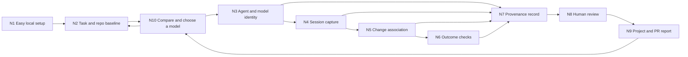

# Anvilmark: ten connected parts for development-model provenance

Date: 2026-10-15  
Status: **Primary product direction adopted on 2026-10-17; local pilot in progress.** The primary subject is the model used **to build the software**. The [canonical brief](../../ANVILMARK-CANONICAL-BRIEF.md) and [tracker](../../PROJECT-TRACKER.md) now state that direction. The existing application-model contract and [earlier ten-node plan](10-node-workflow-plan.md) remain a separate supported workflow. The pilot does not complete the development workflow described here.

## 1. The question and the first promise

The planning question is: **Given the approved architecture and a particular coding task, which available agent/model configuration is likely to complete it at acceptable quality and total cost?** The follow-up question is: **Which agent and model actually participated, what did they change, what checks were run, and what remains unknown?** The useful unit is a **development run**, which may contain multiple turns, models, subagents, human edits, and attempts. One repository does not have one authoring model.

The first product promise is an **evidence-labeled model plan per architecture part, with an explicit confidence assessment**, followed by a local record that shows what happened. A first-run suggestion can use dated public coding evidence, task traits, available models, and a stated budget, but it must be labeled a **provisional estimate**. Strong project-specific recommendations require comparable completed runs. A model that serves the finished application is a separate optional subject and does not answer this question.

The intended first user is a developer already working in a Git repository with a coding agent. The first technical pilot should use one supported agent mode and one real coding task. The public OpenAI Responses starter app remains useful as a repository fixture, but its seven provider call sites are runtime behavior, not evidence of which model built it. Do not present that inventory as the core development-provenance demo.

### Truth rules

1. Source code and Git history alone cannot establish the model that created a change. Historical work without session evidence is **unattributed**.
2. A model name emitted by an agent or API is **tool-reported**, with the exact source, time, client version, and mode. It is not independent proof of the model that served the request. A user-entered name is **declared**, not observed.
3. Model switches, automatic routing, subagents, retries, resumed sessions, and human edits can give one task several contributors. Never reduce them to a false single-model label.
4. A session linked to a diff supports **association**, not automatic line-by-line authorship. Concurrent sessions and edits outside the agent remain ambiguous unless a narrower capture method proves the link.
5. A passing test proves only what that test checked. Model quality or developer productivity needs comparable tasks, repeat runs, review and rework evidence, and stated uncertainty.
6. Default local storage contains metadata, references, hashes, and check results. Raw prompts, responses, tool arguments, secret-bearing logs, and source uploads require an explicit separate choice. The core path needs no Anvilmark account or GitHub grant.
7. “Money saved” requires an actual billing basis and a comparison against the same task under an agreed baseline. API-token prices, subscription allowances, retries, cache behavior, tools, and human review cost are different terms. A cheaper first attempt that causes more rework may cost more per accepted change.
8. Every recommendation states **what its confidence refers to**. An **evidence-confidence score from 0–100** rates the relevance, coverage, sample size, freshness, and cost observability of its supporting records under a published rubric. It is distinct from a calibrated probability that this configuration will pass predeclared checks and human review within a budget. Do not print an unsupported probability or combine quality and cost into an opaque score. If comparable outcomes are insufficient, show the provisional rubric score, its reasons, and the missing evidence.

## 2. One connected workflow

The ten parts share one run ID. A run stores the architecture part and task, repository baseline, proposed configuration and forecast, agent sessions, model-use events, observed changes, checks, reviewer decisions, and coverage gaps. The report reads that record; it does not invent missing events. N10 can propose a provisional first-run choice from external evidence, then revise its estimates from completed local runs. N10 cannot block first setup when evidence is insufficient.

### Minimum record and authority

| Field                      | Required meaning                                                                                                                                              | Source and limit                                                             |
| -------------------------- | ------------------------------------------------------------------------------------------------------------------------------------------------------------- | ---------------------------------------------------------------------------- |
| Architecture part and task | Component/decision reference, task scope, acceptance criteria, repository identity and base tree                                                              | Human-approved plan and Git observation; old history is unattributed         |
| Proposed model plan        | Available agent/model/settings, alternative, evidence date, expected usage/cost range, billing basis, confidence target, method/version and supporting sample | Comparative evidence or explicit assumption; no guaranteed saving or quality |
| Session                    | Agent/client, client version, mode, session/turn IDs when exposed                                                                                             | Agent adapter; identifiers may be absent or change across modes              |
| Model-use event            | Exact model identifier or alias, span/turn/time, root or subagent, switch/fallback                                                                            | Tool-reported metadata with source locator; missing exact model is unknown   |
| Change                     | Before/after tree or diff digest, paths, optional commit/PR link                                                                                              | Git and filesystem observation; association is not proof of authorship       |
| Outcome                    | Named commands/checks, status, duration, reviewer notes, rework                                                                                               | Reproducible local observation or user declaration, labeled separately       |
| Standing                   | Captured, partial, declared-only, unmatched, stale, or tampered                                                                                               | Computed from source availability and hashes; no silent upgrade to verified  |
| Disclosure                 | Consent and retention choice, with optional content capture disabled by default                                                                               | User configuration; no credentials stored in the run                         |

The development storage is a separate local namespace, not a field addition to the existing application-decision schema. Never silently reinterpret `model` or `candidate` in the existing contract as a coding-agent model.

## 3. Plan for every part

### N1. Near-automatic local entry

- **Goal:** install a package or local launcher, point it at the current repository, and get a useful answer in minutes without opening an account.
- **Input → output:** working Git checkout and installed coding agent → read-only compatibility/permission check, proposed local connection, and a visible “capture ready / unavailable / partial” state.
- **Build boundary:** detect supported clients and modes; offer an opt-in agent adapter or wrapper; preserve existing agent settings and offer removal. Browser login is optional only for a later cloud or GitHub feature. Do not ask for provider credentials to create a local record.
- **Research:** R1 measures a clean install, first-run time, required permissions, failures, and whether project-level configuration actually receives session events. Compare wrapper, agent hooks, and read-only export where available.
- **Exit gate:** a new user reaches a metadata-only first run with at most one connection choice and no project-data copy/paste; unsupported modes are named before the user assumes capture works.

### N2. Architecture part, task, and repository baseline

- **Goal:** turn a reviewed architecture into bounded coding tasks and freeze the starting code state so each model choice and resulting change can be assessed.
- **Input → output:** architecture part/decision, repository, selected branch/worktree, user task or issue → run ID, task type (design, bug, feature, refactor, test, research), dependencies, risk, acceptance checks, baseline tree/commit, and explicit unknowns.
- **Build boundary:** the agent can propose a decomposition, but the person reviews material interfaces and task boundaries. Accept a short user description or a cited issue; ask only for missing success criteria that change evaluation. Preserve dirty working-tree status and other concurrent work. Do not infer task intent from a filename or commit title as fact.
- **Research:** R4 tests whether task type and difficulty can be labeled consistently enough for later comparison. R5 times the added user effort.
- **Exit gate:** an existing checkout with uncommitted changes is represented accurately, and a reviewer can identify the task and baseline without reading a private prompt transcript.

### N3. Agent and model identity

- **Goal:** know which tool and model identifiers a development run reports, including model changes and delegated work.
- **Input → output:** supported agent metadata/events → versioned agent identity and ordered model-use events with source/strength labels.
- **Build boundary:** make adapters mode-specific. Codex CLI structured output, Codex desktop, an Agents API session, Claude Code, and GitHub Copilot cannot be assumed to expose the same fields. Record an alias and exact ID separately. If a product hides actual routing, show “configured model” or “unknown served model” as appropriate.
- **Research:** R1 exercises one run in each selected mode; test a model switch, automatic selection, and subagent. Official OpenAI documentation shows structured `codex exec --json` events and Agents API traces, but that does not establish a Codex desktop export. Claude Code documents session hooks and model-switch events; GitHub documents Copilot session logs. Validate each by hands-on capture before promising support.
- **Exit gate:** every shown model has a retrievable event/source and a mode-specific explanation; a hidden or changed model never inherits the initial label silently.

### N4. Session capture with consent

- **Goal:** capture the minimal time-ordered evidence while the agent works.
- **Input → output:** one opted-in session → local event stream containing start/end, turns where available, model events, tool/change markers, failures, and source hashes.
- **Build boundary:** prefer structured supported interfaces over parsing private files or screen scraping. Never interrupt the coding task if recording fails. Buffer safely, deduplicate resumed events, and bound storage. Prompt/response bodies stay off by default; redaction is not treated as proof that content is harmless.
- **Research:** R1 compares completeness, latency, version fragility, and privacy exposure of adapters. R2 reviews the data model against observability conventions and source-provenance concepts without claiming compliance.
- **Exit gate:** a capture failure produces a partial run with its missing interval visible; no secret, prompt body, or source text is stored in the default record.

### N5. Link sessions to changes

- **Goal:** connect a development run to actual repository changes without claiming more authorship than the evidence permits.
- **Input → output:** N2 baseline, N4 event intervals, filesystem/Git state → changed path and diff/tree hashes, associated sessions, and ambiguous or unmatched changes.
- **Build boundary:** support manual edits, parallel agents, worktree switches, rebases, generated files, and commits after the session. Git commit author and co-author are not model identity. File-level association may be possible; line-level attribution needs direct edit events and validation.
- **Research:** R3 uses independently labeled runs with manual edits, two concurrent sessions, and a resumed session. Measure false attribution and abstention.
- **Exit gate:** the known agent patch is linked; the concurrent human patch is marked mixed or unattributed; no existing repository history is retroactively assigned to a model.

### N6. Measure the result of the task

- **Goal:** show what happened after coding, beyond the agent's own completion message.
- **Input → output:** changed tree plus user-selected commands and review → build/test/lint outcomes, elapsed time if observed, review notes, correction cycles, and unavailable measures.
- **Build boundary:** run checks only when the user or project config authorizes them; associate each result with the exact tree hash. Record skipped, timed-out, and flaky checks separately. Cost/token data is optional and labeled with the source and billing limits.
- **Research:** R4 tests a small fixed task suite and whether project-specific checks and reviewer decisions change the apparent result. Public coding benchmarks are research context, not project-specific proof.
- **Exit gate:** the report says which checks actually ran against which code, and an untested change cannot be shown as passing.

### N7. Durable provenance and integrity

- **Goal:** preserve a portable, reviewable record of what Anvilmark observed and where the record may be incomplete.
- **Input → output:** N2–N6 facts → versioned local run record, source locators, content hashes, freshness standing, and append-only correction/annotation history.
- **Build boundary:** validate all imports; retain raw tool reports only by explicit choice; hash the normalized record and linked Git states. Detect local tampering and stale links. A hash proves the record has not changed since capture; it does not prove the agent's self-reported model or that all work was observed. Study source provenance and attestations before using “verified” or signing language.
- **Research:** R2 threat-models forged events, missing spans, rewrites, copied logs, version changes, and clock errors. Decide if the existing project contract can host this object or needs a separate schema.
- **Exit gate:** an altered event or different tree is visibly non-current; declared, tool-reported, and unavailable identities remain distinct across CLI and report views.

### N8. Human review and correction

- **Goal:** let a developer or reviewer correct the task description, mark mixed work, and accept the exact scope of a run report.
- **Input → output:** N7 record and gaps → human annotations/acceptance tied to a record revision and preserved history.
- **Build boundary:** human review can confirm a task or known manual edit; it cannot upgrade unobserved model use into independent proof. Keep machine observations intact; record corrections beside them. Show the shortest useful view first, with expandable source and privacy details.
- **Research:** R5 observes whether reviewers detect deliberately missing model events and mixed edits. Compare a compact card with the raw event list.
- **Exit gate:** a reviewer can explain what is known, reported, declared, and unknown; changing a reviewed record makes the prior acceptance stale.

### N9. Project and PR report

- **Goal:** make development provenance useful at the point a change is reviewed and later maintained.
- **Input → output:** current reviewed runs and Git/PR reference → concise summary of agent/model participation, linked changes, checks, human edits, and coverage gaps.
- **Build boundary:** local report first. A GitHub link or CI check is an optional adapter after local value and permissions are proven. Share metadata only after preview; do not publish private transcripts by default. “No recorded AI use” means no use was captured, not proof that none occurred.
- **Research:** R5 compares the report with existing GitHub Copilot session-to-commit links and developer review habits. Record the actual additional value, manual steps, and disclosure cost.
- **Exit gate:** a reviewer can reach source evidence and identify a partial/mixed run in one view; a stale or tampered record cannot yield a clean provenance statement.

### N10. Recommend and estimate for each development task

- **Goal:** before a coding task starts, suggest an available model/agent configuration and a usage range for that architecture part; after it ends, improve the next estimate from observed outcomes.
- **Input → output:** N2 task/risk and acceptance checks, dated external coding evidence, allowed models and billing plan, then reviewed project runs → candidate configurations, expected usage/cost range, evidence strength, a task-specific success-confidence estimate when calibratable, uncertainty, escalation point, and a proposed choice.
- **Build boundary:** compare agent + model + settings + tools + context as a configuration, not the model name alone. A first-run suggestion is provisional; missing relevant evidence produces “insufficient evidence.” Always show the versioned 0–100 **evidence-confidence rubric score** and the factors behind it; this score is not a success probability. Define a second numeric score, when supported, as the estimated probability of **passing the task's predeclared checks and human review within the stated budget**. Show the number of comparable runs, task similarity, evidence age, and an uncertainty interval; check calibration on held-out tasks. When those outcome data are absent, withhold the probability rather than making one up. Estimate **cost per accepted task**, including retries and review effort where measurable, rather than only token price. When a user pays a fixed subscription, distinguish allowance consumption from incremental cash saving. Use paired tasks, repeat runs, tests, human review and rework before claiming that one choice is better. Do not rank developers or infer productivity from lines of code. The person chooses the configuration.
- **Research:** R4 studies coding-agent evaluation, cost-aware routing and probability calibration, then runs a small blinded, reproducible project-specific comparison. R5 tests whether the suggestion changes a real user's next choice and lowers total cost without reducing acceptance quality.
- **Exit gate:** before the first run, the proposal shows an alternative, evidence age, confidence target/basis, and a forecast range rather than an asserted saving. Before showing a numeric probability, held-out predictions must be compared with observed acceptance frequencies and miscalibration reported. A measured saving claim requires two comparable configurations, source-linked usage/billing, the same acceptance gates, and no material increase in rework or defects; the report refuses an unsupported universal “best model.”

## 4. Research before implementation decisions

| Study                                   | Concrete experiment                                                                                                                                                                                                                                                                                                                                                                                                                                                                                                                         | Decision unlocked                                                                                                                                      |
| --------------------------------------- | ------------------------------------------------------------------------------------------------------------------------------------------------------------------------------------------------------------------------------------------------------------------------------------------------------------------------------------------------------------------------------------------------------------------------------------------------------------------------------------------------------------------------------------------- | ------------------------------------------------------------------------------------------------------------------------------------------------------ |
| **R1. Capture feasibility**             | Run the same small coding task through Codex CLI, Codex desktop if an export is documented, and one second agent mode. Freeze versions; collect only consented metadata. Test start, switch, subagent, resume, failure, and removal. Count available identity fields, missing events, setup steps and disclosure.                                                                                                                                                                                                                           | Which first adapter is supportable; wrapper versus hook versus export; honest model-identity strength.                                                 |
| **R2. Provenance/integrity**            | Threat-model the normalized record against omitted/forged events, copied logs, clock skew and modified Git state. Compare SLSA source-provenance concepts and OpenTelemetry GenAI conventions; write a minimal schema and privacy review.                                                                                                                                                                                                                                                                                                   | Separate development-run contract or amendment; hash/signature language; retention and export boundary.                                                |
| **R3. Change association**              | Freeze ground-truth edits in one-agent, manual-plus-agent, concurrent-agent, resumed, and rebased cases. Compare event and Git associations; count false claims and abstentions.                                                                                                                                                                                                                                                                                                                                                            | Safe granularity of change attribution and when to show “mixed/unknown.”                                                                               |
| **R4. Outcome and comparison**          | Define several real architecture-part tasks with frozen checks; run two agent/model configurations under matched conditions, repeat, blind-review results, and record corrections, time, token/allowance use and actual billing terms where available. Compare cost per accepted task and a fixed-model baseline. Hold out tasks for calibration checks: group predicted success probabilities and compare them with actual accepted frequencies, with sample-size uncertainty. Use public coding benchmarks only to design the experiment. | Whether N10 can forecast use, issue a calibrated confidence score, recommend by task, and support a savings claim without lowering acceptance quality. |
| **R5. Adoption and product comparison** | Observe a new developer's clean setup and a real reviewer using the resulting report; compare existing agent session/history and PR views. Repeat on their next task without a guided demo.                                                                                                                                                                                                                                                                                                                                                 | Whether the record saves review effort, which report belongs in daily work, and whether GitHub/cloud integration earns its permissions.                |

Primary starting sources checked for this proposal:

- [Official OpenAI Codex `exec --json` evaluation example](https://developers.openai.com/blog/eval-skills) and [Agents API tracing](https://developers.openai.com/api/docs/guides/agents-api/tracing). These establish structured events and model fields for the documented modes, not a universal desktop integration.
- [Claude Code hooks reference](https://code.claude.com/docs/en/hooks), including session and model-switch events. Hands-on testing must check exact installed-version behavior.
- [GitHub Copilot agent sessions](https://docs.github.com/en/copilot/how-tos/copilot-on-github/use-copilot-agents/manage-and-track-agents), which already link some cloud-agent commits to session logs. The pilot must show value beyond that existing view.
- [SLSA source/build provenance distinction](https://slsa.dev/spec/v1.2/provenance) and [OpenTelemetry semantic conventions](https://opentelemetry.io/docs/concepts/semantic-conventions/) for interoperability and terminology; neither automatically certifies Anvilmark records.
- [SWE-bench paper](https://arxiv.org/abs/2310.06770) as a reproducible issue-resolution task pattern. A benchmark score cannot replace evaluation on the pilot's work.
- [Scrouting coding-agent routing study](https://arxiv.org/abs/2608.04804) as a research lead: its reported savings depend strongly on a verified repository handoff, and its cheapest-model ablation tied its router on the studied benchmark. Do not use the headline saving as an Anvilmark forecast.
- [Probability-calibration research](https://www.jmlr.org/papers/v23/22-0658.html) for checking whether stated success probabilities match observed frequencies. A confidence number without a named outcome and calibration record is not a measured probability.
- [GitHub Copilot Auto](https://docs.github.com/en/copilot/concepts/models/auto-model-selection) and [Cursor model selection](https://prod.cursor.com/help/models-and-usage/available-models) show that generic model routing already exists. The pilot must establish value from architecture-specific requirements, project evidence, transparent cost estimates, and reviewable outcomes.

## 5. Pilot acceptance story and stop/go gates

1. Start in an existing Git repository with one coding task and a known dirty/clean baseline. Install locally and connect one supported agent mode without a browser account.
2. Before coding, propose a model and alternative for that architecture part with a usage range, evidence limits, billing basis, and acceptance gate. Then make a change in a real agent session; capture its tool-reported model and a linked code change. Include a model switch or delegated step if the adapter supports it; otherwise mark that coverage absent.
3. Add a human edit and run a named check. The run report must show the mixed contribution, exact code state checked, and honest uncertainty.
4. Review the record locally. Modify an event or the code tree and show that the prior standing is stale/tampered rather than clean.
5. Repeat with a second configuration only after R4 has frozen comparable task cases. N10 may then compare cost per accepted task and quality outcomes without claiming a universal winner.

**Gate before expanding the pilot:** name a first real pilot user, repository, architecture part and supported agent mode; finish R1 across model switches and failure cases; review the run schema, privacy defaults, billing assumptions, acceptance gates, and the five ambiguity cases (unknown model, switch, subagent, manual edit, parallel session). The local slice exists, but automated routing and savings claims remain deferred until R4 produces comparable measured outcomes. Existing runtime-model features are not evidence that the broader development workflow works.

## 6. First local pilot implementation (2026-10-16)

The project owner authorized a first local build around the broader goal of a single AI-development record and restriction-aware model choice. The `anvilmark development` command is an **experimental sidecar** under `.anvilmark/development/`; it does not migrate the existing application-model contract. It records one architecture summary, one task, two or more declared Codex CLI model options, restrictions on allowed models and projected API cost, an exact interactive plan approval, a Codex CLI run, changed paths, token usage, check exits, and an exact interactive run review. Previous plan contents are preserved by hash. The [fixture](../../examples/development-pilot/README.md) exercises the path.

The first isolated real Codex CLI run changed one file and passed its named check. Its event stream reported token usage but did not report the served model, so the record correctly says `configured_only`. Subscription cash cost and savings remain unknown. The run lacked a prior human architecture approval and is recorded as unapproved; it cannot be accepted retroactively.

On 2026-10-17 the pilot added a local SQLite development-evidence index. A plan may describe task kind, language set, and risk. `development recommend` rebuilds the index from archived plans and local run/review records, then compares only runs for the same architecture part, exact profile, configured agent, and model. An invalid archived plan, missing prior approval, changed review hash, mixed-model run, or reported model differing from the configured one is excluded from single-setup accepted evidence. Human rejection is recordable. A candidate can also have an explicit source-scoped public-model mapping; `--catalog-db` displays its dated source observations and identity/relevance notes without converting public scores into a task-quality pass. When two eligible API-billed setups have accepted local outcomes, the command may show an **exploratory sample cost per accepted task** using declared rates and observed tokens. Subscription cash remains unknown. These small samples are descriptive and do not justify a calibrated success probability, automated routing, or a savings claim. The real user-approved pilot, cross-agent adapters, provider restriction evidence, and unified website view remain open.
