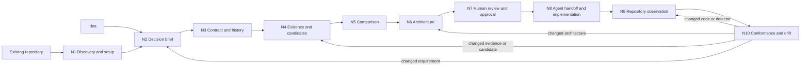

# Anvilmark: ten-node workflow plan

> Scope note, 2026-10-15: This plan describes **models called by an application at runtime**. The project owner clarified a different primary question: **which coding-agent models were used to build the project?** The proposed replacement direction is in [the ten-node development provenance plan](10-node-development-provenance-plan.md). This document remains a record of the earlier runtime-model plan and its onboarding study; it is not evidence that the new direction has been implemented or ratified across the existing canonical brief.

Date: 2026-10-15  
Status: Product and research plan for review. This document does not authorize implementation or claim user validation.

## 1. Goal and first user

Anvilmark should become the durable decision record and repeatable check for changes to an AI application. A person makes or revises a model, provider, deployment, or data-flow decision occasionally. The coding agent reads that decision while implementing it. A local or CI check evaluates each relevant change against the same decision and shows source evidence, gaps, and drift.

**Chosen first entry path:** an existing AI-enabled repository, as selected by the project owner on 2026-10-15. The proposed first user is an engineer working in a TypeScript/JavaScript repository that calls an AI provider and has at least one meaningful privacy, quality, cost, or provider rule. This pilot focus does not exclude idea-first projects later. The idea path enters at Node 2; an existing repository enters at Node 1. A public [Responses starter app](https://github.com/openai/openai-responses-starter-app) at a pinned commit is the first technical setup pilot; a user-owned pilot and real first user remain to be selected.

**Core use case:** a pull request changes a model, provider, prompt, or sensitive data path. Anvilmark shows which approved decision applies, whether the change satisfies it within supported scope, which facts were measured or declared, and what remains unknown. A demonstrated violation has a source location and an actionable correction. A missing evaluation cannot become a quality pass.

The five product requirements behind this plan are:

1. First setup creates a source-linked draft with minimal user work.
2. The approved project contract is the sole decision authority across agent, CLI, website, and CI.
3. Workload evidence supports decisions; public model scores are research signals until matched to the actual workload.
4. Relevant pull requests get a concise, reproducible check with honest pass, fail, and unknown results.
5. Coverage, privacy, and repeat use are measured on real projects before broad claims or rollout.

### Initial success measures (targets to test, not current results)

| Measure                      | Proposed first-pilot target                                                                                                            | How to observe                                                                    |
| ---------------------------- | -------------------------------------------------------------------------------------------------------------------------------------- | --------------------------------------------------------------------------------- |
| Time to first useful result  | At most 10 minutes from a working install to a source-linked inventory and editable brief on a supported repo                          | Screen-record or time an unaided first run                                        |
| Manual project-data transfer | Zero copy/paste steps among website, CLI, agent, and MCP                                                                               | Record every handoff in the pilot                                                 |
| Human questions              | Ask only questions that can change a hard filter, evidence need, or candidate comparison; aim for five or fewer before the first draft | Log questions, skipped answers, and later corrections                             |
| Claim traceability           | Every proposed repository-derived hard rule links to a checked excerpt or is marked inferred/unknown                                   | Blindly audit a sample of draft fields                                            |
| Trustworthy PR result        | No known false pass on the labelled pilot changes; fail includes exact rule and source evidence; unknown is distinct                   | Independent human labels, deliberate violation, correction, and ambiguous variant |
| Repeat value                 | A team chooses to run the check on a later AI-related change without a guided demo                                                     | Follow up after the first pilot                                                   |

These targets should be revised from observed pilot data. They are not release guarantees.

## 2. How the nodes connect

The diagram shows the principal path, not a forced wizard. Evidence and architecture can iterate before approval. The contract is read throughout the path. A scan is an observation; a conformance result is a bounded judgment about the selected snapshot.

### Authority and handoff rules

| Object                                                                                 | Authority                                                          | Written by                                                       | Read by                                                                           |
| -------------------------------------------------------------------------------------- | ------------------------------------------------------------------ | ---------------------------------------------------------------- | --------------------------------------------------------------------------------- |
| Project intent, constraints, workloads, candidates, decisions, architecture, approvals | Validated .anvilmark/project.yaml plus committed local history     | Local contract transaction and explicit human approval operation | Comparison, context, MCP, scanner, conformance, local review                      |
| Public model research snapshots                                                        | Local model catalog with source identity, fetch time, and hash     | Source adapters or explicit refresh                              | Candidate discovery and evidence review; never an automatic workload-quality pass |
| Project evaluation and hardware evidence                                               | Contract evidence records with exact attribution and admissibility | Reviewed import or bounded adapter attachment                    | Comparison, approval review, context                                              |
| Agent proposals                                                                        | Attributed draft/history records                                   | User-selected agent through validated adapter or opt-in MCP      | Human review; proposals cannot approve or silently weaken hard constraints        |
| Generated Mermaid, CALM, agent context                                                 | Derived views of contract at a named revision/time                 | Context generator                                                | People and agents; never read back as authority                                   |
| Repository scan                                                                        | Versioned, source-linked observation of selected files/config      | Local scanner                                                    | Conformance and review; does not change contract                                  |
| Conformance report                                                                     | Current contract plus fresh repository inputs and engine version   | Local checker                                                    | Developer, agent, CI, optional website projection                                 |

An expired evidence source changes current evidence standing; a material change to approval-covered content changes approval standing. These are separate conditions and both must be visible. Existing validation, remote projection, secret rejection, and exact approval hashing remain the baseline; see the [project contract](../../packages/project-contract/README.md), [context](../../packages/context/README.md), and [conformance](../../packages/conformance/README.md) documentation.

## 3. Near-automatic first setup: the design to investigate first

The first experience begins inside the user's chosen coding agent or a local launcher pointed at a repository. The agent can interpret prose and propose fields; Anvilmark checks exact files, source excerpts, identities, schema, and policy consequences. Nothing in the repository is executed for discovery. Repository text, comments, and ADRs are untrusted input.

| Step                               | Proposed user experience                                                                                                                                                                 | Machine boundary and result                                                                                                                                                                                             |
| ---------------------------------- | ---------------------------------------------------------------------------------------------------------------------------------------------------------------------------------------- | ----------------------------------------------------------------------------------------------------------------------------------------------------------------------------------------------------------------------- |
| 0. Install and open                | User installs one supported local package/launcher, opens a repository, and invokes Anvilmark from the agent or CLI.                                                                     | Doctor reports runtime, package, permissions, and optional adapters. No account, hosted model, or provider key is required for a useful first result. Clean-install packaging must be verified before this is promised. |
| 1. Read-only discovery             | Anvilmark inventories languages, AI dependencies, call sites, provider endpoints/model literals, existing Anvilmark state, and bounded local decision documents.                         | Produces source spans, file hashes, detector coverage, unsupported SDKs, and explicit unknowns. It cannot infer organizational policy from code alone.                                                                  |
| 2. Draft brief                     | The agent submits the user's prompt and structured claims with exact cited excerpts from allowed local files.                                                                            | A valid draft records user-stated, source-quoted, inferred, and unknown fields separately. A source quotation proves the words appeared in a file, not that the policy is current or approved.                          |
| 3. Resolve consequential questions | Show conflicts between user prompt, cited decisions, current contract, and observed code. Ask for workload, data boundary, quality target, or budget only when it can change a decision. | Every unanswered item remains explicit. The agent cannot turn an ADR or its own suggestion into an approved hard rule.                                                                                                  |
| 4. Show first useful result        | Show the repository inventory, editable workload brief, candidate gaps, and one possible data-flow path.                                                                                 | No approval or compliance claim yet. The user can save a validated draft without selecting a winner.                                                                                                                    |
| 5. Prepare decision                | Gather exact candidates and admissible evidence, compare them, and render a review of alternatives, unknowns, source dates, and content hash.                                            | The existing local approval operation remains the only binding sign-off until an equally reviewable local surface is designed and verified.                                                                             |
| 6. Continue in the agent           | The agent reads the current approved decision and its revision from MCP, changes code, and invokes the check.                                                                            | Record the revision consumed and the files changed; an agent's statement that it complied is not a conformance result.                                                                                                  |
| 7. Enable repeat checking          | Offer a reviewed CI configuration for affected PRs and a local equivalent.                                                                                                               | CI runs on the user's runner, emits a bounded verdict and evidence report, and preserves source locality. Cloud upload is optional and cannot be a prerequisite for core checking.                                      |

**Existing pieces:** setup/doctor/workshop, CLI elicitation and approval, repository inventory and scanner, generated context, default read-only project MCP, and opt-in cited draft/candidate research in the current checkout. The first implementation slices add `anvilmark start`: one local invocation inventories an existing repository, prompts for a user-authored application description when interactive, creates a draft, or resumes an existing project. An optional `--connect-codex` writes a project-scoped MCP entry with approval prompts for draft-writing tools. A local tarball was installed into a clean temporary directory and its CLI ran on the public technical pilot. It does not infer a workload or policy or connect GitHub. **Unproven or missing:** published-package and unaided install experience, agent-led ADR discovery and conflict extraction, automatic question prioritization, one continuous local review, actual agent consumption, and an end-to-end PR check. The [agent-first proposal](agent-first-decision-flow.md), [guided workshop](milestones/07-guided-workshop.md), and [tracker](../../PROJECT-TRACKER.md) provide the current baseline.

### Entry and account boundary

Installing a package is one delivery method, not the product entry point. The entry point is the action a developer takes to get a useful result in the repository. Keep these routes connected to the same local contract and checker:

| Route                                   | First useful result                                            | Setup and trust cost                                                                                                           | Proposed role                                                                                                                       |
| --------------------------------------- | -------------------------------------------------------------- | ------------------------------------------------------------------------------------------------------------------------------ | ----------------------------------------------------------------------------------------------------------------------------------- |
| One command in an open repository       | Local inventory, cited draft, and visible unknowns             | Requires a working runtime or later standalone distribution; no account or GitHub grant                                        | First real pilot and reference path; compare clean package, temporary runner, and standalone distribution before choosing packaging |
| Coding-agent command/tool               | The same result in the agent conversation                      | Detect and configure a supported client with a reviewed local file change; verify actual tool use                              | Preferred interaction for developers already using an agent; backed by the local command, not a second decision store               |
| GitHub Actions workflow                 | Repeat check on a pull request after reviewed workflow setup   | Requires repository workflow edit and runner access; no Anvilmark-hosted code upload by default                                | First GitHub integration to test after the local checker earns trust                                                                |
| GitHub App and optional browser sign-in | Select repositories in a browser and display or publish checks | Requires selected-repository permissions, organization approval in some cases, a service, and explicit code/data access policy | Later option if pilots show that workflow setup or distributed team review is the bottleneck                                        |

**Working recommendation:** start from a local repository with one obvious command or agent invocation; let it discover the Git remote without demanding GitHub authorization. Use a browser authentication flow only when a user chooses a hosted feature that needs an identity. A GitHub connection should be offered when enabling PR checks or shared review, with its purpose and requested repository access shown at that moment. The current `anvilmark login` accepts a cloud sync token; it is not a browser sign-in flow and is not required for local work ([CLI guide](../../packages/cli/README.md)).

The first GitHub PR experiment can use a reviewed [Actions workflow](https://docs.github.com/en/actions/get-started/quickstart) running the local checker on the repository's runner. A later [GitHub App installation](https://docs.github.com/en/apps/using-github-apps/installing-a-github-app-from-a-third-party) can scope access to selected repositories; installation and user authorization are different grants, and an organization may require owner approval. A hosted app changes the data-access and operations model, so it must be justified by pilot friction rather than assumed to be the easiest route. Test whether a browser login removes enough real work to offset the added grant and service setup.

**PR gate design finding (2026-10-15):** a normal `conformance` run is the gate; `conformance --check` verifies report freshness and can return current even for a failed report. The first implementation correction makes an empty rule set `NOT EVALUATED` with exit 2. A PR job must keep the approved contract, scanner declarations, and workflow from a trusted base revision, then scan the proposed source under a read-only token; taking policy or workflow files from the PR lets the change remove its own checks. GitHub's [pull request security guide](https://docs.github.com/en/actions/reference/security/securely-using-pull_request_target) documents the read-only fork token on `pull_request` and the risk of executing untrusted code under `pull_request_target`. A real check also needs a released, pinned Anvilmark package, a reviewed scanner declaration and approved rule on a pilot repository, and a required status check configured by the repository owner. The public starter pilot has no approved rule, so it cannot legitimately produce a passing PR gate yet.

**Setup decision experiment:** run the present CLI/workshop and a read-only agent-assisted draft on the same two existing repositories. Observe elapsed time, actions, data transfers, incorrect or uncited claims, questions, and ability to reach a useful first result. Compare the proposed onboarding with the repository-instruction/agent workflow documented by [GitHub Copilot](https://docs.github.com/en/copilot/tutorials/cloud-agent/improve-a-project) and the agent detection/MCP wiring documented by [Archcore](https://docs.archcore.ai/cli/commands/). Read [CIAO](https://arxiv.org/abs/2604.08293) for repository-to-architecture suggestions and [R2Code](https://arxiv.org/abs/2604.22432) for requirements-to-code links; test their ideas with independently checked citations rather than accepting generated structure as fact. These sources motivate experiments, not proof that the proposed setup will work.

## 4. Plan for every node

### N1. Entry, discovery, and setup

- **Goal:** reach an accurate, useful local inventory from an idea or repository with almost no configuration; make existing-repo entry the first pilot.
- **Input → output:** user prompt and selected repository → read-only inventory, eligible decision-document excerpts, coverage limits, and draft questions. Idea-only input → initial intent and explicit missing fields.
- **Current base:** CLI start/init/inventory and scanner draft-config; opt-in MCP draft intake requires the agent to supply excerpts and claims. `start` composes inventory with a user-authored draft but has not completed the source-cited decision-document path.
- **Work to design/build later:** single launcher and project selection; bounded ADR/document discovery; deterministic AI call inventory; agent proposal protocol for source-cited claims; conflict view; idempotent resume when a draft already exists; setup diagnostic and failure recovery.
- **Research decision:** compare agent-assisted extraction against deterministic inventory plus manual questions. Measure factual precision, omission rate, unsupported claims, time, and remote disclosure. Use R1 and R3 below.
- **Exit gate:** on the pilot repo, a new user obtains a source-linked draft and coverage report without project-data copy/paste; no repository-derived hard rule is silently accepted; wrong paths, unsupported SDKs, and unreadable documents appear as gaps.

### N2. Decision brief and workload decomposition

- **Goal:** express what each AI workload does and what would make an option unacceptable or preferable.
- **Input → output:** user statements, cited local decisions, and N1 observations → workloads, data classifications, hard/soft constraints, quality metrics, usage, latency, priorities, and open questions in a validated draft.
- **Current base:** CLI elicit/edit and browser draft export; the agent path can submit one workload and cited proposed constraints.
- **Work to design/build later:** minimum brief for first comparison; conflict resolution between sources; relevance ordering for questions; structured provenance per claim; controlled support for multiple workloads without forcing all five Atlas workloads into every project.
- **Research decision:** test whether a small set of decision-changing questions yields the same candidate exclusions as a full interview. Blindly compare drafts with a developer-authored brief. Use R1.
- **Exit gate:** every hard constraint has a named source/authority and explicit scope; missing usage or output classification stays unknown; two reviewers can identify what the user stated versus what the agent inferred.

### N3. Contract, validation, and revision identity

- **Goal:** keep one durable project object whose decision meaning survives UI, agent, and CI handoffs.
- **Input → output:** validated draft edits → atomic .anvilmark/project.yaml revision, history marker, content hashes, and current/stale approval standing.
- **Current base:** project-contract draft.5 schema, referential validation, evidence floors, secret checks, deterministic serialization, and CLI transaction/history.
- **Work to design/build later:** define the smallest contract projection needed by setup and PR checks; specify migration rules before schema additions; expose exact revision identity in every review/report; test concurrent edit and recovery paths. Keep catalog snapshots separate from authority until explicit evidence import.
- **Research decision:** review whether CALM can express architecture controls and flows needed by this contract without duplicating fields; retain the existing generated-export boundary unless a concrete pilot gap proves otherwise. Use R3.
- **Exit gate:** every interface reports the same project and decision revision; an edit to approval-covered content invalidates current approval; an obsolete generated or scan artifact cannot become current by display alone.

### N4. Candidate identity and evidence

- **Goal:** show what is known about exact model, provider, deployment, configuration, hardware, price, license, quality, and latency without upgrading research signals into proof.
- **Input → output:** source-scoped catalog snapshots, official records, measured workload runs, hardware observations → attributable candidate/evidence records and explicit gaps.
- **Current base:** evidence adapters, manual import, Hugging Face and Artificial Analysis research, manual SQLite snapshots, limited pinned hardware sizing.
- **Work to design/build later:** reviewed model/revision/provider/endpoint mapping; source refresh and failure policy; official price/region/license records with scope; exact evaluation identity and replay manifest; optional measured runtime import; source-rights review before public display.
- **Research decision:** replay the same small labelled workload through an existing evaluator such as [promptfoo](https://www.promptfoo.dev/docs/integrations/ci-cd/) or [Langfuse](https://langfuse.com/docs/evaluation/experiments/experiments-ci-cd/). Use [ReproEvalCard](https://aclanthology.org/2026.acl-short.22/) and [Evaluation Cards](https://arxiv.org/abs/2606.09809) to audit the metadata and comparability of imported results. Use R2.
- **Exit gate:** two real candidates have exact identities and dated source evidence; a missing/mismatched evaluation leaves quality unknown; a third party can identify the prompt, dataset, model configuration, provider, evaluator, and run version behind a quality claim.

### N5. Candidate and architecture comparison

- **Goal:** help a person make a justified choice while preserving failed hard rules, unknowns, and trade-offs.
- **Input → output:** N2 constraints plus N4 evidence and N6 architecture options → per-candidate constraint standing, cost/latency assumptions, alternatives, and a reviewable decision report.
- **Current base:** CLI compare and evidence-gap logic, no aggregate score.
- **Work to design/build later:** concise comparison report shared by CLI/local review/MCP; cost breakdown by workload and volume; architecture-sensitive data-boundary and deployment facts; sensitivity to stale evidence and assumptions; guidance on the next most useful measurement.
- **Research decision:** compare paired evaluation results and uncertainty rather than leaderboard rank alone; use [Adding Error Bars to Evals](https://arxiv.org/abs/2411.00640) as a method candidate. Test whether a simple quality-gated eligible-cost baseline is as useful as a more complex ranking. Use R2.
- **Exit gate:** a reviewer can explain why each candidate passed, failed, or remains unknown, identify excluded cost terms, and see at least one meaningful alternative without interpreting an overall score.

### N6. Architecture and policy graph

- **Goal:** make data movement, deployment, interfaces, and decision bindings reviewable and checkable.
- **Input → output:** workloads, candidate paths, and policy → validated graph with nodes, relationships, trust boundaries, interfaces, decision bindings, and derived Mermaid/CALM/agent views.
- **Current base:** graph editing/validation, agent-proposed element confirmation, generated views and shared context facts.
- **Work to design/build later:** source-cited agent graph proposal, graph-versus-policy checks, declared/observed/divergent/unmapped review, and a way to show possible crossings without claiming they are safe.
- **Research decision:** test [software reflexion models](https://www.cs.ubc.ca/~murphy/papers/rm/fse95.html) against the pilot's manually reviewed mapping; compare [FINOS CALM controls and flows](https://calm.finos.org/core-concepts/) with the current graph/export. Use R3.
- **Exit gate:** every material remote data crossing names the data classification and constraint; unconfirmed agent elements cannot support a definitive safety claim; generated views match the contract revision and never become authoritative edits.

### N7. Human review and exact approval

- **Goal:** let a person accept one decision with its exact candidate, constraints, evidence, alternatives, and unresolved risks.
- **Input → output:** proposed decision and current evidence → human-readable covered content, content hash, explicit acceptance/decline, append-only approval record.
- **Current base:** interactive local CLI review/approve and approval hashing; no real project acceptance yet.
- **Work to design/build later:** a compact local review invoked from the agent; review of evidence age and unknowns; change summary when reapproval is needed; confirmation that the displayed content is what gets approved. Any new review surface must use the existing validation and transaction boundary.
- **Research decision:** observe comprehension and missed risk on the current CLI review versus a compact evidence card. Use R2 and R5; do not infer that a shorter screen is safer.
- **Exit gate:** a real pilot user can explain the accepted option and unresolved items; changing an approved covered field makes the old approval non-current; neither an MCP proposal nor a CI job can sign the decision.

### N8. Agent handoff and implementation

- **Goal:** make the approved revision available during coding and record what the agent consumed.
- **Input → output:** current approved decision and scope → agent-readable context with revision/hash; application change with a recorded consumed revision and check request.
- **Current base:** deterministic agent context, read-only MCP queries, manual client guidance, and an opt-in project-scoped Codex connection from `start`.
- **Work to design/build later:** one agent-facing setup instruction that works from the selected repo; short decision queries by workload/component; explicit revision acknowledgement in the implementation record; changed-file impact queries; no manual JSON transfer.
- **Research decision:** compare current MCP/context flow with agent instruction support documented by [GitHub Copilot](https://docs.github.com/en/copilot/how-tos/copilot-on-github/use-copilot-agents/copilot-code-review). Measure whether the agent actually retrieved the applicable decision, not merely whether it was configured. Use R1 and R4.
- **Exit gate:** a real coding agent makes one change after reading the approved revision; the record names agent/client version, contract revision, changed files, and check result; stale/unapproved content is visibly non-instructional.

### N9. Repository scan and decision mapping

- **Goal:** observe the code relevant to a contract without fabricating whole-program or runtime certainty.
- **Input → output:** selected source snapshot, declaration config, detector versions, contract revision → source-linked calls, data-flow traces, mappings, unknowns, and coverage limits.
- **Current base:** bounded TypeScript/JavaScript scanner, inventory, draft config, source evidence, real-repo benchmark.
- **Work to design/build later:** pilot SDK recognizer gaps; reviewable mapping corrections; changed-file impact without losing whole-repository context; freshness checks on CI inputs; language expansion only when the pilot corpus warrants it.
- **Research decision:** compare source-only analysis with a small multi-service case informed by [CloudFlow](https://www.usenix.org/conference/usenixsecurity25/presentation/raffa). Compare mapping suggestions with source-linked human labels and [R2Code](https://arxiv.org/abs/2604.22432). Use R3.
- **Exit gate:** observed provider/model and protected-data path point to file/call evidence; unsupported languages, dynamic values, cross-service paths, or ineffective sanitizer assumptions remain explicit limits; no false pass in the labelled pilot set.

### N10. Conformance, PR result, and drift loop

- **Goal:** check a relevant change against the current approved decision and route each drift cause back to the node that owns it.
- **Input → output:** fresh N9 scan, N3 approval standing, N4 evidence standing, and selected CI change → per-rule pass/fail/unknown/not-applicable, source-linked local report, concise PR summary, and next action.
- **Current base:** provider allowlist and bounded data-flow rules; local CLI/MCP conformance; offline violation/correction/unknown replay.
- **Work to design/build later:** reliable CI launcher and exit policy, before/after PR impact report, machine-readable report adapter (including SARIF where it fits), evidence and contract freshness display, measured-runtime feedback import where available.
- **Research decision:** compare the report with [GitHub code scanning/SARIF integration](https://docs.github.com/en/code-security/how-tos/find-and-fix-code-vulnerabilities/integrate-with-existing-tools) and the PR feedback of [promptfoo](https://www.promptfoo.dev/docs/integrations/github-action/) and [Langfuse](https://langfuse.com/docs/evaluation/experiments/experiments-ci-cd/). [ArchRails](https://archrails.io/index.html) publicly describes an agent-generated CALM draft and an architecture PR gate, so an architecture-only gate cannot establish differentiation; its gated enforcement has not been tested here. A generic AI review already exists in [Copilot](https://docs.github.com/en/copilot/how-tos/copilot-on-github/use-copilot-agents/copilot-code-review). Test whether Anvilmark's workload, model, provider, evidence, and exact approved-rule links change reviewer decisions. Use R4 and R5.
- **Exit gate:** the pilot's deliberate violation fails with source evidence, correction passes within stated scope, dynamic/unsupported behavior is unknown, stale inputs cannot produce compliant status, and a reviewer understands the result from the PR without opening several tools.

### One connected acceptance story

Use the [Atlas support-ticket scenario](01-shared-benchmark-scenario.md) as a synthetic rehearsal, then repeat the same shape on the selected real repository. N1 finds the AI call and a prior privacy decision; N2 records classification as a workload and keeps conflicting claims open; N3 stores the reviewed draft; N4 links exact managed/local candidates to dated facts and a matching test set; N5 shows which hard rules pass, fail, or need evidence; N6 declares redaction and inference boundaries; N7 records one human-approved revision; N8 has the agent consume it and change the app; N9 maps the changed provider call and data path to source; N10 fails a raw-ticket remote call, passes its supported correction, and reports dynamic dispatch as unknown. The real-pilot record must distinguish synthetic rehearsal from actual user decision and actual agent use.

### Node acceptance cases to freeze before implementation

| Node | Expected case                                                                   | Refusal, uncertainty, or drift case                                                                        |
| ---- | ------------------------------------------------------------------------------- | ---------------------------------------------------------------------------------------------------------- |
| N1   | Inventory names the repository's known AI call and cites its source             | Unsupported SDK or unreadable ADR is listed as a coverage gap; quoted code text cannot instruct the agent  |
| N2   | One workload and its material constraints are traceable to user or cited source | Conflicting user/ADR claims become a question; unknown usage does not become zero                          |
| N3   | The same revision/hash is visible through CLI, MCP, and review                  | Invalid reference, secret, concurrent edit, or tampered history refuses a commit/current status            |
| N4   | Exact candidate and matching measured evaluation are attributable               | Public score, wrong provider/config, stale price, or approximate name match cannot clear the relevant gate |
| N5   | Two options show separate hard, soft, cost, and evidence standings              | Missing usage or uncertain quality remains unknown; no aggregate score masks a failed hard rule            |
| N6   | Approved decision links to a confirmed node and classified crossing             | Unconfirmed agent node or undeclared data classification cannot imply a safe crossing                      |
| N7   | Human review covers the exact candidate/evidence revision accepted              | Changed covered content makes the prior approval non-current; cancellation writes no approval              |
| N8   | Agent response identifies the approved revision it consumed                     | Stale or unapproved decision is labelled non-instructional; merely configuring MCP proves no consumption   |
| N9   | Scan links observed call, model/endpoint, and bounded data path to source       | Runtime-selected value, unknown import, cross-service path, or unsupported language stays visible          |
| N10  | Deliberate violation fails, corrected source passes within stated scope         | Ambiguity is unknown; stale scan, contract, or evidence cannot yield a clean compliance claim              |

## 5. Research and product-study work before build decisions

Research is attached to a decision and a reproducible experiment. Published findings describe their own settings; competitor documentation describes supported behavior, not Anvilmark performance. The existing [paper map](research-paper-map.md), [recent-paper update](research-paper-map-2026.md), and [hands-on competitor matrix](02-competitor-hands-on-matrix.md) are starting records, not substitutes for the pilot.

| Study                        | Question and method                                                                                                                                                                                                                                                                        | Evidence to retain                                                                                                                     | Decision unlocked                                                               |
| ---------------------------- | ------------------------------------------------------------------------------------------------------------------------------------------------------------------------------------------------------------------------------------------------------------------------------------------ | -------------------------------------------------------------------------------------------------------------------------------------- | ------------------------------------------------------------------------------- |
| R1. Automatic setup          | On two real repositories, compare current CLI/workshop, deterministic inventory plus manual brief, and agent-cited draft. Use the same task and observer. Count setup actions, minutes, questions, data transfers, claim errors, and repository disclosure.                                | Exact versions, command/call log, field-level source audit, screen notes, failure cases                                                | Which setup steps can be automated and which require a question or confirmation |
| R2. Decision evidence        | Run the same labelled cases against two exact candidate configurations using an existing evaluator; audit reproducibility metadata, paired differences, pricing identity, freshness, and review comprehension.                                                                             | Dataset definition, prompt/config hashes, raw outputs, evaluator identity, source URLs/dates, reviewer corrections                     | Evidence import contract, comparison report, and what can clear a quality gate  |
| R3. Architecture and mapping | Independently label a pilot repo's AI calls, data flows, components, and one cross-service case. Compare current scanner, manual mappings, and agent-proposed links.                                                                                                                       | Frozen labels, source spans, precision/recall/abstention, mapping effort, false passes, review time                                    | Which graph and scanner changes are justified                                   |
| R4. PR workflow              | Run the same deliberate violation, correction, and ambiguous change through local Anvilmark and a trial PR. Inspect accessible product documentation/source for Copilot review, promptfoo, Langfuse, and GitHub code scanning; exercise a product directly only where access is available. | PR screenshots/output, time to diagnosis, manual transfers, permissions/data egress, exact versions, observed-versus-documented labels | CI format, blocking policy, report shape, integration boundary                  |
| R5. Adoption                 | Ask a real team to use the approved contract on one actual change, then observe its next relevant change without a guided demo.                                                                                                                                                            | User decisions, repeat/abandon reason, setup time, findings acted on, false positives, reviewer feedback                               | Whether the narrow PR-centered product is worth expanding                       |

For reverse engineering, use the fixed [Atlas scenario](01-shared-benchmark-scenario.md) or the same real pilot change, record access level (documentation, public surface, hands-on), exact input/output, manual transfers, permissions, and unknowns. Do not infer absence from missing marketing text. Gated behavior stays unverified until directly tested.

## 6. Decisions required before product code

| Decision               | Proposed answer                                                                                                             | Evidence or owner needed                                   |
| ---------------------- | --------------------------------------------------------------------------------------------------------------------------- | ---------------------------------------------------------- |
| First entry path       | Existing AI-enabled repository first, chosen by the project owner on 2026-10-15; idea-only path converges at N2             | Select a real pilot repo and confirm the first user        |
| Daily-use surface      | Local/CI check on relevant PRs, with agent access to the same contract                                                      | R4 and R5; website remains a possible human review surface |
| Decision authority     | Existing validated local project contract and human approval boundary                                                       | Confirm no pilot requirement forces a schema amendment     |
| Agent authority        | May propose cited drafts/options/architecture, may not silently accept hard policy or sign a decision                       | R1 field audit and review usability                        |
| Quality evidence       | Matching measured evaluation for a hard workload-quality pass; public scores support discovery only                         | R2 and exact candidate/eval identity                       |
| CI blocking            | Block on demonstrated current-rule failures within supported scope; report unknown separately and define team policy for it | R3 labelled coverage and R4 reviewer trial                 |
| First language/SDK set | Current TypeScript/JavaScript scope, expanded for gaps found in the pilot                                                   | R3 coverage data                                           |
| Cloud and website role | Optional presentation/sync after the local path is coherent                                                                 | R5 repeat-use evidence and data-flow review                |

## 7. Sequence and build gate

**Planning and evidence sequence, beginning now:**

1. Select a real pilot repository and one actual or planned AI-related change. Freeze its starting commit, expected decision, and independently labelled violation/correction/unknown cases.
2. Execute R1 first. Use its failure log to finalize the N1–N3 setup design and the minimum brief.
3. Execute R2 and R3 on the same pilot, then define exact candidate/evidence and graph/mapping interfaces.
4. Execute R4 with the approved decision and a real agent change. Record all manual transfers.
5. Review all ten node exit gates and the seven decisions above. Mark unresolved research explicitly; choose the first implementation slice only after its dependencies and acceptance case are clear.

**Implementation order after that gate:** (A) coherent agent-led local setup and review; (B) approved-contract handoff and PR conformance; (C) project-specific evidence comparison; (D) broader language, runtime, and enterprise integrations according to pilot demand. This order is a proposal, not authorization to start coding.

Implementation has begun with local `start`, an optional project Codex connection, and a correction that makes an empty conformance rule set inconclusive. The public technical pilot checks setup mechanics; broader product and release claims remain gated until there is a named user and user-owned pilot, exact inputs/outputs and authority boundaries for affected nodes, frozen acceptance examples, a measurement plan, resolved research questions that could change architecture, and an agreed rule for pass/fail/unknown. A node is not complete merely because code or a demo exists. The [current tracker](../../PROJECT-TRACKER.md) still marks the real human approval and actual agent-consumption baseline open.
