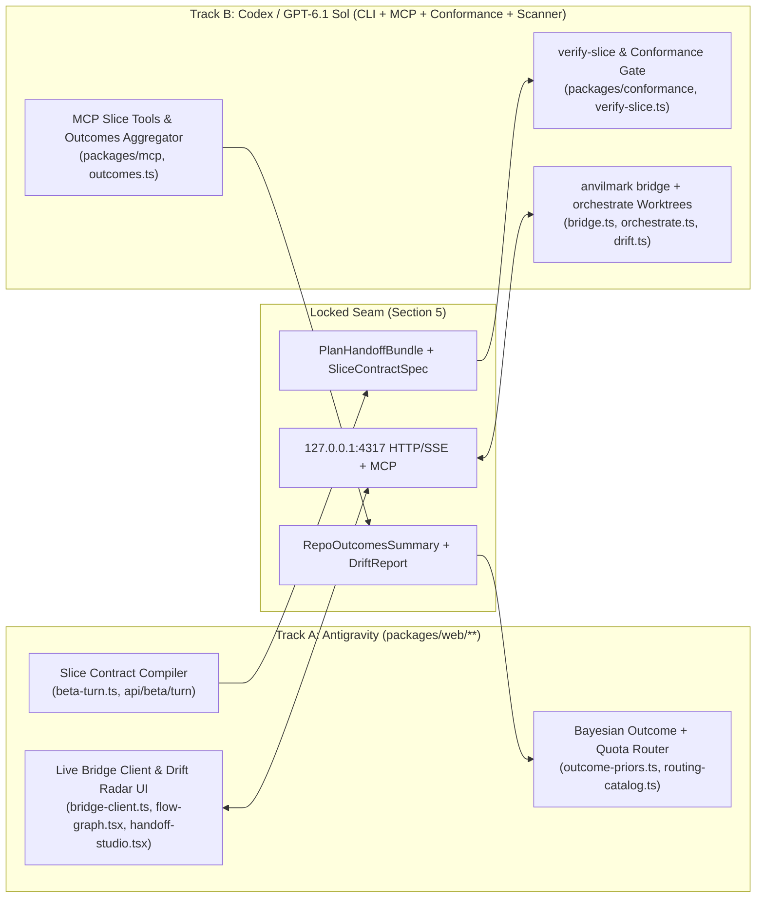

# ANVILMARK Groundbreaking Roadmap & Parallel Track Split (Track A + Track B)

Date: **November 27, 2026**  
Base branch: **`feat/beta-studio-and-local-flow` (`6d61dcf`)**  
Status: **Active execution specification & locked cross-agent contract**

---

## 1. Executive Summary

With Waves 1 and 2 shipped on `feat/beta-studio-and-local-flow`, ANVILMARK now delivers a complete **front-half planning and handoff studio** (`/beta` 3-mode conversational planner, SSE streaming, live slice/decision editing, trust-boundary visualization, multimodal intake, `anvilmark export-context`, and 6-target `anvilmark apply-plan` handoff) connected to both `models.sqlite` evidence and self-hosted GGUF models on `am-server`.

However, ANVILMARK's canonical product thesis ([`ANVILMARK-CANONICAL-BRIEF.md`](../../ANVILMARK-CANONICAL-BRIEF.md)) is **not** to be just another spec generator. Its thesis is to be **the local-first decision, conformance, and cost-per-accepted-task control plane across coding agents**.

This report documents:

1. **Current architectural limitations** preventing closed-loop conformance and project-specific learning.
2. **Six category-defining capabilities** that turn ANVILMARK into a flight controller and verification compiler for multi-agent software engineering.
3. **Sourced model-routing justification** for running **Track B on Codex with `GPT-6.1 Sol` (`gpt-6.1-sol`)** using dated evidence from `packages/web/data/models.sqlite` (`2026-10-27` snapshot).
4. **Locked JSON/HTTP seam contracts** and a **zero-overlap 50/50 work split** between **Track A (Antigravity — `packages/web/**`)** and **Track B (Codex / `gpt-6.1-sol` — `packages/cli/**`, `packages/mcp/**`, `packages/conformance/**`, `packages/scanner/**`)**.

---

## 2. Current Limitations (As of `6d61dcf`)

1. **One-Way "Throw Over the Wall" Handoff (Open Loop)**
   - `/beta` exports `CLAUDE.md`, `.cursor/rules/anvilmark-plan.mdc`, `AGENTS.md`, `PLAN.md`, and `.anvilmark-plan.json`, and `anvilmark apply-plan` writes `.anvilmark/development/active-plan.json`.
   - Once Claude Code, Codex, or Cursor begins editing files, `/beta` has zero visibility into retries, failing checks, actual token/quota burn, conformance violations, or human post-agent rework.
   - `.anvilmark/development/active-plan.json` is not yet connected to the provenance and review ledger in `packages/cli/src/commands/development.ts`.

2. **Public Benchmark Priors Instead of Repo-Specific Empirical Evidence**
   - `packages/web/lib/routing-catalog.ts` scores candidates from a static `models.sqlite` snapshot and fixed slice token heuristics (`~22k input / 4.5k output`).
   - Public Arena Elo does not reflect how a model performs on _this specific repository_, nor does linear API token math capture rolling 5-hour windows, weekly frontier caps, or \$0 marginal LAN GPUs (`am-server`).

3. **Advisory Markdown Instructions Instead of Deterministic Enforcement**
   - Writing rules into `CLAUDE.md` or `.cursor/rules` only _asks_ coding agents to stay within task scope and trust boundaries. Without a deterministic gate over `git diff` and static imports, agents routinely touch out-of-scope files, add unapproved packages, or cross trust boundaries.

4. **Manual File-Drop Repository Grounding**
   - `anvilmark export-context` safely extracts structural repo inventory without leaking secrets or source contents, but requires manual JSON export/import and stops short of live AST boundary edges (`packages/scanner`) and real-time `git status` / slice state synchronization.

5. **Single-Slot Local Inference & Text-Only GGUF Runtime on `am-server`**
   - `am-server` (`100.88.244.77`, RTX 3060 12 GB VRAM, `--models-max 1`) incurs cold GGUF swaps when switching between fast triage and 27B–30B planners, and none of the six GGUF presets currently mount an `mmproj` vision projector (triggering text-only fallback on attached wireframes).

6. **Browser-Local Thread State & Disconnected Surfaces**
   - Studio threads persist in browser `localStorage` (`anvilmark.beta.threads.v1`), isolated from repo-committed ADRs and CI conformance gates.

---

## 3. Six Groundbreaking Leaps

### Pillar 1: Executable Slice Contracts ("A Compiler for Agent Plans")

Compile every `/beta` task slice into a deterministic `SliceContract`: allowed file globs, forbidden file globs, forbidden package additions, trust-boundary import rules, and executable verification commands. Gate slice completion with `anvilmark verify-slice` and `packages/conformance` before human review.

### Pillar 2: Closed-Loop Bayesian "Cost-Per-Accepted-Slice" Router

Aggregate real agent run outcomes from `.anvilmark/development/` (configured vs. served model, retries, check pass rate, token usage, and human rework ratio) into `.anvilmark/development/outcomes-summary.json`. Blend observed project outcomes with `models.sqlite` public priors via Empirical Bayes shrinkage so Studio routing adapts to what actually lands cleanly on the user's repo.

### Pillar 3: Zero-Copy Local Daemon Bridge (`anvilmark bridge`) + Live MCP Slice Server

Replace manual file uploads/downloads with a loopback-only (`127.0.0.1`), token-paired local daemon (`anvilmark bridge`) and MCP slice tools (`packages/mcp`). Studio pulls live repo + scanner context in 1 click, applies plans directly to disk, and streams live slice verification states over SSE while coding agents pull and verify slices via MCP.

### Pillar 4: Multi-Worktree DAG Orchestrator + Cross-Vendor Adversarial Review

Use `dependsOn` across `task_slices` to schedule independent slices into isolated `git worktree` branches (`anvilmark orchestrate`), run `verify-slice`, and enforce **cross-vendor review** (never allowing the authoring model family to approve its own security or boundary compliance).

### Pillar 5: Subscription Quota Budgets & Hybrid Cloud/Local Arbitrage

Model real developer billing constraints (`plenty | conserve | exhausted` frontier quota states + `am-server` LAN availability). Automatically route reconnaissance, boilerplate, CRUD, and test scaffolding to `am-server` (`Qwen3-Coder-30B` / `gemma-4-12b`) or fast tier models, reserving scarce frontier quota strictly for high-ambiguity architecture, concurrency, and auth slices.

### Pillar 6: Bidirectional Architecture Drift Radar

Compare planned `flows` in `.anvilmark/development/active-plan.json` against actual code boundaries scanned by `packages/scanner`. Highlight drifted edges, unapproved external calls, and boundary violations directly inside Studio's `FlowGraph` and CLI conformance reports.

---

## 4. Evidence-Backed Model Choice for Track B: Why `GPT-6.1 Sol` (`gpt-6.1-sol`)

Using ANVILMARK's own local evidence database (`packages/web/data/models.sqlite`, `2026-10-27` snapshot):

| Metric (`models.sqlite`)           | `GPT-6.1 Sol (Max)` (`gpt-6.1-sol`)          | `GPT-6 Astra (Max)` (`gpt-6-astra`)          | Implication for Track B                                                                                                        |
| ---------------------------------- | -------------------------------------------- | -------------------------------------------- | ------------------------------------------------------------------------------------------------------------------------------ |
| **Agent Arena (`config='agent'`)** | **Rank #5** (`0.1364`)                       | Rank #3 (`0.1396`)                           | Virtually tied (`0.003` delta) on end-to-end coding agent capability                                                           |
| **Agent Praise/Complaint**         | **Rank #2** (`0.3126`)                       | Rank #3 (`0.2976`)                           | Higher human developer satisfaction on multi-file feature execution                                                            |
| **WebDev / TypeScript Arena**      | **Rank #4** (`1749.3` Elo)                   | Rank #2 (`1774.3` Elo)                       | Top-tier TypeScript/Node monorepo accuracy                                                                                     |
| **Context / Max Output**           | `922,000` in / `128,000` out (`reasoning=1`) | `922,000` in / `128,000` out (`reasoning=1`) | Easily holds CLI, MCP, Conformance, and Scanner context simultaneously                                                         |
| **API / Quota Burn Equivalent**    | **\$2 in / \$10 out per 1M**                 | \$10 in / \$50 out per 1M                    | **5× more quota- and cost-efficient** than Astra                                                                               |
| **Bash Reliability (No Prereqs)**  | Rank #32 (`0.0191`)                          | Rank #13 (`0.1071`)                          | **Key Mitigation:** Sol performs at frontier level when exact schemas, file boundaries, and test commands are provided upfront |

**Decision:** **Yes — `GPT-6.1 Sol` (at `high` or `xhigh`/`max` reasoning effort in Codex)** is the optimal model for Track B, _provided_ we hand it locked schemas, explicit package ownership, and deterministic `pnpm` check commands (included in Section 5 & Section 6 below).

---

## 5. Locked Cross-Track Seam Contracts

Both tracks MUST implement against these exact TypeScript/JSON shapes so Track A and Track B integrate cleanly without touching each other's packages.

### 5.1 Extended Slice Contract in `anvilmark.plan-handoff.v1`

`version` remains `"anvilmark.plan-handoff.v1"` for full backward compatibility. Each `plan.tasks[i]` object in `PlanHandoffBundle` accepts an **optional** `contract` object (and `PlanHandoffBundle` accepts optional `quotaMode`):

```ts
export interface SliceContractSpec {
  /** Posix-style repo-relative globs this slice is permitted to create/modify (empty = unrestricted). */
  allowedGlobs: string[];
  /** Posix-style repo-relative globs this slice MUST NOT touch (e.g. ".env*", "packages/auth/**"). */
  forbiddenGlobs: string[];
  /** Shell commands that must exit 0 for deterministic verification (e.g. "pnpm --filter @anvilmark/cli test"). */
  verificationCommands: string[];
  /** If false, changes to package.json dependencies/devDependencies fail verification. */
  allowDependencyChanges: boolean;
  /** Expected trust boundaries touched by this slice (matched against plan.flows[].boundary). */
  expectedBoundaries: string[];
  /** Preferred cross-vendor reviewer family (must differ from authoring provider when available). */
  reviewerFamily?: "anthropic" | "openai" | "google" | "local_oss";
}
```

> **Important compatibility rule for Track B (`packages/cli/src/commands/apply-plan.ts`):** Update `HandoffPlan`'s `tasks` `z.strictObject(...)` to allow `contract: SliceContractSchema.optional()`, and `PlanHandoffBundle` to allow `quotaMode: z.enum(["plenty", "conserve", "exhausted"]).optional()`, so both v1 bundles without `contract` and upgraded bundles with `contract` validate cleanly.

### 5.2 Slice Verification Report (`anvilmark verify-slice --json`)

```ts
export interface SliceVerificationReport {
  schemaVersion: "anvilmark.slice-verification.v1";
  verifiedAt: string; // ISO-8601
  sliceId: string;
  passed: boolean;
  changedFiles: string[];
  violations: Array<{
    kind:
      | "out_of_scope_file"
      | "forbidden_file"
      | "unapproved_dependency_change"
      | "boundary_violation"
      | "check_command_failed";
    path?: string;
    command?: string;
    detail: string;
  }>;
  checkResults: Array<{
    command: string;
    exitCode: number;
    durationMs: number;
    outputExcerpt: string;
  }>;
}
```

### 5.3 Repo Outcomes Summary (`.anvilmark/development/outcomes-summary.json`)

Generated by Track B (`anvilmark outcomes --json` / `/v1/outcomes`) and consumed by Track A (`packages/web/lib/outcome-priors.ts`):

```ts
export interface RepoOutcomesSummary {
  schemaVersion: "anvilmark.outcomes-summary.v1";
  generatedAt: string; // ISO-8601
  repoName: string;
  totalRecordedRuns: number;
  models: Array<{
    model: string; // e.g. "gpt-6.1-sol", "claude-opus-5-5", "qwen3-coder-30b"
    provider?: string;
    taskCategory?:
      "architecture" | "backend" | "frontend" | "tests" | "general";
    attempts: number;
    acceptedFirstPass: number;
    acceptedAfterRetry: number;
    rejected: number;
    meanRetries: number;
    /** 0.0 = accepted untouched, 1.0 = completely rewritten before acceptance */
    meanReworkRatio: number;
    meanInputTokens: number;
    meanOutputTokens: number;
    observedUsdPerAccepted?: number | null;
    lastObservedAt: string;
  }>;
}
```

### 5.4 Architecture Drift Report (`/v1/drift` & `anvilmark drift --json`)

```ts
export interface ArchitectureDriftReport {
  schemaVersion: "anvilmark.drift-report.v1";
  scannedAt: string; // ISO-8601
  planTitle: string;
  status: "aligned" | "drifted" | "no_active_plan";
  plannedFlowsCount: number;
  observedEdgesCount: number;
  items: Array<{
    severity: "error" | "warning" | "info";
    kind:
      | "undeclared_flow"
      | "missing_planned_flow"
      | "boundary_bypass"
      | "unapproved_ai_sdk";
    from: string;
    to: string;
    boundary?: string;
    evidencePaths: string[];
    detail: string;
  }>;
}
```

### 5.5 Local Daemon Bridge HTTP + SSE Protocol (`anvilmark bridge`)

- **Bind address:** Strictly `127.0.0.1` (default port `4317`, configurable via `--port`). Never bind `0.0.0.0`.
- **Auth:** Startup generates a 32-byte hex token printed to terminal (`Bridge pairing URL / token`). Every request (except `OPTIONS` preflight) requires `Authorization: Bearer <token>` or `X-Anvilmark-Bridge-Token: <token>` (or `?token=<token>` on `EventSource` `/v1/events`).
- **CORS:** Allow `http://localhost:3000` and `http://127.0.0.1:3000` (configurable via `--allow-origin`).
- **Endpoints:**
  - `GET /v1/health` → `{ ok: true, version: "1", repoName, projectDir, hasActivePlan: boolean }`
  - `GET /v1/context` → returns `RepoContextSnapshot` (same schema as `anvilmark export-context --json`)
  - `GET /v1/outcomes` → returns `RepoOutcomesSummary`
  - `GET /v1/drift` → returns `ArchitectureDriftReport`
  - `POST /v1/apply-plan` → body `PlanHandoffBundle`, runs `applyPlan` logic atomically, returns `{ applied: true, writtenFiles: string[] }`
  - `POST /v1/verify-slice` → body `{ sliceId: string, runChecks?: boolean }`, returns `SliceVerificationReport`
  - `GET /v1/events` → `text/event-stream` emitting `slice_status`, `plan_applied`, and `drift_updated` events

---

## 6. Strict 50/50 Work Split & File Ownership

> **Global Off-Limits Rule (External Agent Protection):**  
> Neither Track A nor Track B may modify, format, stage, or revert:
>
> - `packages/web/app/components/**` (specifically `site-header.tsx`)
> - `packages/web/components/ui/liquid-glass-navbar.tsx`
> - `packages/web/app/page.tsx`, `packages/web/app/home.module.css`, `packages/web/app/layout.tsx`
> - `packages/web/app/{login,models,workspace,start}/**`



### Track A — Antigravity (50%): Studio Control Plane, Bayesian Router & Live Drift UI

- **Owned Paths:** `packages/web/app/beta/**`, `packages/web/app/api/beta/**`, `packages/web/lib/**`, `packages/web/test/**`
- **Deliverables:**
  1. **Executable Slice Contract Generation:** Extend planner prompts, `GeneratedPlan`, and `PlanHandoffBundle` (`beta-turn.ts`, `planner.ts`, `api/beta/turn/route.ts`) to synthesize `SliceContractSpec` (`allowedGlobs`, `forbiddenGlobs`, `verificationCommands`, `allowDependencyChanges`, `expectedBoundaries`, `reviewerFamily`) per task slice, plus inline contract badges/editors in `plan-output.tsx`.
  2. **Empirical Bayes Outcome Router & Quota Arbitrage:** Build `packages/web/lib/outcome-priors.ts` and extend `routing-catalog.ts` + `prompt.tsx` with:
     - Beta-Binomial shrinkage blending `RepoOutcomesSummary` with `models.sqlite` Arena scores and displaying `"Proven on this repo (N/M first-pass)"` badges.
     - Quota budget selector (`Plenty` / `Conserve frontier` / `Frontier exhausted — Local + Fast only`) that automatically shifts recon/CRUD/test slices to `am-server` or fast models while preserving frontier models for high-risk slices.
  3. **Zero-Copy Bridge Client & Live Drift Radar UI:** Build `packages/web/lib/bridge-client.ts` and integrate into `prompt.tsx`, `handoff-studio.tsx`, `plan-output.tsx`, and `flow-graph.tsx`:
     - `"Connect Local Bridge"` pairing popover (`127.0.0.1:4317` + token) for 1-click live repo context + outcomes sync, 1-click `"Apply directly to repo"`, and 1-click `"Verify slice"` triggers.
     - Bidirectional **Drift Radar** overlay on `flow-graph.tsx` rendering `ArchitectureDriftReport` (`aligned` green vs. `undeclared_flow` / `boundary_bypass` red/amber callouts with file evidence).

### Track B — Codex (`gpt-6.1-sol`) (50%): Enforced Slice Conformance, MCP Server, Local Bridge & Worktree Orchestrator

- **Owned Paths:** `packages/cli/**`, `packages/mcp/**`, `packages/conformance/**`, `packages/scanner/**`
- **Deliverables:**
  1. **Schema Upgrade & Deterministic `verify-slice` Command (`apply-plan.ts`, `verify-slice.ts`, `packages/conformance`):**
     - Extend `PlanHandoffBundle` in `packages/cli/src/commands/apply-plan.ts` with optional `contract: SliceContractSchema` and `quotaMode`.
     - Add `anvilmark verify-slice --slice <id> [--plan FILE] [--no-checks] [-C DIR] [--json]` to enforce `allowedGlobs`, `forbiddenGlobs`, `allowDependencyChanges` (via `git status --porcelain` / `git diff`), scanner boundary checks, and bounded execution of `verificationCommands`, returning `SliceVerificationReport`.
  2. **MCP Slice Execution Tools & Repo Outcomes Aggregator (`packages/mcp/src/slice-tools.ts`, `outcomes.ts`):**
     - Add `--slice-execution` flag and tools (`list_plan_slices`, `get_slice_contract`, `verify_slice`, `record_slice_outcome`) to `packages/mcp/src/project-server.ts` & `project-tools.ts` so MCP-capable agents pull slices from `.anvilmark/development/active-plan.json` and verify conformance before completion.
     - Add `anvilmark outcomes [-C DIR] [--write] [--json]` reading `.anvilmark/development/` records + slice outcome logs and writing `.anvilmark/development/outcomes-summary.json` (`RepoOutcomesSummary`).
  3. **Architecture Drift Detector, `anvilmark bridge`, and `anvilmark orchestrate` (`drift.ts`, `bridge.ts`, `orchestrate.ts`):**
     - Add `anvilmark drift [-C DIR] [--json]` comparing `.anvilmark/development/active-plan.json` `plan.flows` against `packages/scanner` findings (`ArchitectureDriftReport`).
     - Add `anvilmark bridge [-C DIR] [--port 4317]` implementing the loopback-only (`127.0.0.1`), token-authenticated HTTP + SSE bridge (Section 5.5).
     - Add `anvilmark orchestrate [-C DIR] [--dry-run] [--max-parallel N] [--json]` resolving topological waves over `plan.tasks` (`dependsOn`), preparing isolated `git worktree` branches under `.anvilmark/worktrees/<slice-id>`, generating cross-vendor reviewer assignments (`reviewerFamily !== authorProvider`), and running `verify-slice` per completed worktree.

---

## 7. Parallel Git Workflow & Verification Gates

To avoid `.git/index.lock` contention when Track A and Track B run simultaneously on the same machine:

- **Recommended isolation for Track B (Codex):** Run Codex in a dedicated Git worktree branched from `feat/beta-studio-and-local-flow`:
  ```bash
  git worktree add ../AM-track-b -b feat/track-b-engine feat/beta-studio-and-local-flow
  ```
  _(Alternatively, if run in the same checkout, Track B must stage only explicit paths under `packages/cli`, `packages/mcp`, `packages/conformance`, and `packages/scanner` — never `git add -A`.)_
- **Track A Verification Gate:**
  - `pnpm --filter @anvilmark/web test`
  - `pnpm --filter @anvilmark/web exec tsc --noEmit`
- **Track B Verification Gate:**
  - `pnpm --filter @anvilmark/conformance build && pnpm --filter @anvilmark/scanner build && pnpm --filter @anvilmark/mcp build && pnpm --filter @anvilmark/cli build`
  - Focused Vitest suites in `packages/cli/test/{apply-plan,verify-slice,outcomes,drift,bridge,orchestrate}.test.ts` and `packages/mcp/test/slice-tools.test.ts`
